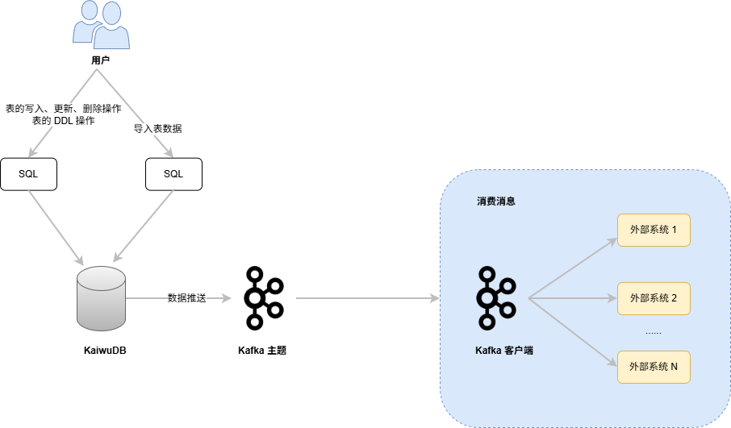

# 实时数据推送

KWDB 提供开箱即用的实时数据推送功能，旨在获取数据库中关键业务的数据变化信息和时序表的 DDL 操作，将这些信息包装为消息对象以 JSON 格式推送到 Kafka 主题（Kafka Topic）中，方便下游业务获取和消费。KWDB 支持在单个时序库、单个时序表、单个时序表的指定列或多个时序表上创建数据推送管道。

::: warning 说明
KWDB 向 kafka 推送消息时，如某条消息不符合 Kafka 的限制条件，例如最大消息超过默认的 1MB，系统会报错并将错误原因记录在日志中。
:::

## 工作原理

KWDB 支持使用 SQL 语句创建数据推送任务，将时序数据和时序表的 DDL 操作实时同步到 Kafka 主题中。用户使用 Kafka 客户端读取 Kafka 主题中的数据，然后写入到 Kafka 第三方消息组件或者目标数据库。



- 当时序库上已经创建数据推送管道
  - 如果已开启数据推送服务，允许用户创建、修改和删除时序表。用户创建、修改或删除时序表后，系统将对应的 DDL 操作语句推送到数据推送管道的消息队列，然后重启数据推送服务并按照时序库中最新的时序表结构继续推送数据，包括用户通过 `INSERT`、`DELETE` 和 `UPDATE` 语句产生的数据和时序表中已存在的历史数据。
  - 如果未开启数据推送服务，允许用户创建、修改和删除时序表。再次启动数据推送服务之后，系统按照时序库中最新的时序表结构继续推送数据。

- 当时序表上已经创建数据推送管道
  - 如果已开启数据推送服务，允许用户修改和删除时序表。用户修改或删除时序表后，系统将对应的 DDL 操作语句推送到数据推送管道的消息队列，然后重启数据推送服务并按照最新的表结构继续推送数据，包括用户通过 `INSERT`、`DELETE` 和 `UPDATE` 语句产生的数据和时序表中已存在的历史数据。如果目标表被删除、重命名、或目标表的列被删除，系统不再推送该表或列的数据。
  - 如果未开启数据推送服务，允许用户修改和删除时序表。再次启动数据推送服务之后，按照最新的表结构推送数据。如果目标表被删除、重命名、或目标表的列被删除，系统不再推送该表或列的数据。

- 当时序表的指定列上已经创建数据推送管道
  - 如果已开启数据推送服务，允许用户修改和删除时序表。用户修改或删除时序表后，系统将对应的 DDL 操作语句推送到数据推送管道的消息队列，然后重启数据推送服务并按照最新的表结构继续推送数据，包括用户通过 `INSERT`、`DELETE` 和 `UPDATE` 语句产生的数据和时序表中已存在的历史数据。如果目标表或表中的列被重命名或删除，系统不再推送该表或列的数据。
  - 如果未开启数据推送服务，允许用户修改和删除时序表。再次启动数据推送服务之后，系统按照最新的表结构推送数据。如果目标表或表中的列被重命名或删除，系统不再推送该表或列的数据。

## 使用限制

- KWDB 不支持推送关系表。
- 不支持聚合函数、类型转换、排序规则、系统列引用或非不可变内置函数的过滤条件。
- 如果推送对象为单个数据库或者多个时序表，不支持指定列和过滤条件，也不支持修改推送对象。
- 当过滤条件中指定的列被删除或重命名之后，会导致数据推送服务运行失败。此时用户需要修改过滤条件后再重启数据推送服务。
- KWDB 不支持实时数据推送时应用数据去重规则。
- 历史数据如果不在真实场景或者乱序且乱序时间差较大，可能出现历史推送遗漏。
- 在集群高可用环境下，新扩容的节点在与业务建立连接之前，新节点 CDC 所在的表操作将处于阻塞状态。

## 功能特性

- 数据推送对象
  - KWDB 支持推送单个时序库、单个时序表、单个时序表的指定列或多个时序表。
  - 支持使用 `WITH` 关键字指定包括推送目标在内的数据推送参数。
  - 对于单表推送，支持使用 `WHERE` 子句创建带有过滤条件的数据推送任务。
- 数据来源
  - 实时数据：开启数据推送任务后，用户使用 `INSERT`、`DELETE`、`UPDATE` 语句写入、删除、更新的数据和源端发生的 DDL 操作。
  - 历史数据
    - 乱序插入数据库中的数据。
    - 开启数据推送任务前，数据库中已有的数据。开启数据推送任务后，系统将分批发布这些数据。不支持推送源端发生的历史 DDL 操作。
    - 数据推送任务暂停期间，用户使用 `INSERT`、`DELETE`、`UPDATE` 语句写入、删除、更新的数据和源端发生的 DDL 操作。
    - 用户通过 `IMPORT`、`INSERT INTO ... SELECT` 语句导入的数据。

    ::: warning 说明
    不支持数据库级别的导入。
    :::

- 支持的 SQL 操作：`INSERT`、`DELETE`、`UPDATE`、DDL 语句

    ::: warning 说明

    - 目前，KWDB 只支持根据 Primary Tag 删除数据或者更新 Tag 值。
    - 开启数据推送后，如需执行 DDL 操作，建议间隔至少 4 秒。
    - 当 `DELETE` 或 `UPDATE` 操作的返回结果是 0 行时，系统不会进行推送。

    :::

  - `DELETE`：支持推送数据列和普通 Tag 列的 `DELETE` 操作。在数据推送执行过程中，如果源端执行 `DELETE` 操作，该操作将被实时推送至目标端。对于在推送任务暂停期间发生的 `DELETE` 操作，系统也会在任务恢复后继续推送至目标端，确保数据一致性。
  - `UPDATE`：支持推送数据列和普通 Tag 列的 `UPDATE` 操作。对于数据列，如果目标端配置去重策略，则在目标端进行去重更新。在发布任务执行过程中，如果源端执行 `UPDATE` 操作，该操作将被实时推送至目标端。对于在发布任务暂停期间发生的 `UPDATE` 操作，系统也会在任务恢复后继续推送至目标端，确保数据一致性。

- 数据过滤规则：对于单表推送，支持对实时数据推送中的数据进行行级简单条件过滤，包括：
  - 支持数据列、Primary Tag 列和普通 Tag 列的过滤运算。
  - 时间戳列：支持基于时序表时间戳列的条件过滤。
- 数据推送配置
  - KWDB 采用异步方式将时序数据以 JSON 的格式作为消息推送到 Kafka 主题中。如果用户指定的推送目标不合法，则系统在尝试推送后以错误消息形式提示用户。Kafka 连接示例如下：

    ```bash
    kafka://{kafka_cluster_address}:{port}?topic_name={topic_name}&tls_enabled=true&ca_cert={ca_cert}&sasl_enabled=true&sasl_user={sasl_user}&sasl_password={sasl_password}
    ```

    - `kafka_cluster_address`：Kafka 集群的 IP 地址。
    - `port`：端口号，默认为 `9093`。
    - `topic_name`：数据推送的目标 Kafka 主题的名称。
    - Kafka 认证方式及其参数
      - `tls_enabled`：若设置为 `true`，开启与 Kafka 的 TLS 连接。需与 `ca_cert` 参数配合使用。
      - `ca_cert`: Base64 编码的 CA 证书，用于 Kafka 的 TLS 认证。说明：用户可以使用 `base64 -w 0 ca.cert` 命令编码 CA 证书。
      - `client_cert`：Base64 编码的 PEM 证书，需与 `client_key` 参数配合使用。
      - `client_key`：Base64 编码的 PEM 证书私钥，需与 `client_cert` 参数配合使用。
      - `sasl_enabled`：若设置为 `true`，表示采用 SASL/PLAIN 认证协议。必须同时设置 `sasl_user` 和 `sasl_password` 参数。
      - `sasl_user`：SASL 用户名。
      - `sasl_password`：SASL 密码。

  - 目前，KWDB 仅支持推送一到多条 JSON 格式的数据。消息示例如下：
    - 正常数据推送消息（消息类型为 `insert`）

        ```json
        {
          "change": [
            {
              "kind": "insert",
              "database": "benchmark",
              "schema": "public",
              "table": "cpu",
              "columnnames": ["k_timestamp", "hostname", "max_usage_user" ],
              "columntypes": [ "integer", "text", "integer" ],
              "columnvalues": [
                [ 173441827100000, "www.example1.com", 77],
                [ 173441827200000, "www.example1.com", 80],
                [ 173441827300000, "www.example1.com", 65]
              ]
            }
          ]
        }
        ```

    - 重启补发数据消息（消息类型为 `snapshot`）

        ```json
        {
          "change": [
            {
              "kind": "snapshot",
              "database": "benchmark",
              "schema": "public",
              "table": "cpu",
              "columnnames": ["k_timestamp", "hostname", "max_usage_user" ],
              "columntypes": [ "integer", "text", "integer" ],
              "columnvalues": [
                [ 173441827100000, "www.example1.com", 77],
                [ 173441827200000, "www.example1.com", 80],
                [ 173441827300000, "www.example1.com", 65]
              ],
            }
          ]
        }
        ```

    - 删除操作消息。

        ```json
        {
          "change": [
            {
              "kind": "delete",
              "database": "benchmark",
              "schema": "public",
              "table": "table2",
              "statement": "DELETE FROM benchmark.public.table2 WHERE time > '2023-05-01 10:00:00';"
            }
          ]
        }
        ```

    - 更新操作消息。

        ```json
        {
          "change": [
            {
              "kind": "update", 
              "database": "benchmark",
              "schema": "public",
              "table": "table1",
              "statement": "UPDATE benchmark.public.table1 SET tag3 = true WHERE tag1 = 1 AND tag2 =1;"
            }
          ]
        }
        ```

    - DDL 操作消息。通过 `kind` 字段区分 DDL 操作，支持 `create_table`（创建表）、`alter_table`（修改表）和 `drop_ table`（删除表）选项。

        ```json
        {
          "change": [
            {
              "kind": "create_table",
              "database": "benchmark",
              "schema": "public",
              "table": "tb1",
              "statement":"CREATE TABLE benchmark.public.tb1(k_timestamp TIMESTAMPTZ NOT NULL, ml FLOAT) TAGS (id INT NOT NULL, type VARCHAR(30) NOT NULL) PRIMARY TAGS (id);"
            }
          ]
        }
        ```

  - 用户可以设置全局最大数据推送失败次数。当最大数据推送失败次数超过设置值后，停止向外推送数据。用户可以使用 `SET CLUSTER SETTING ts.pipe.sink_max_retries` 命令设置最大数据推送失败次数。目前，最大数据推送失败次数为 5。
  - 支持通过 `buffer_size` 参数为每个推送任务单独配置是否立即推送数据。当取值为 `0` 时，立即推送数据。
  - 支持通过 `ignore_history` 参数配置是否开启推送历史数据。开启实时数据推送服务后，如果设置推送历史数据，系统查询历史数据量，同步历史数据。KWDB 再自动捕获并推送相关数据的更新。
  - 支持通过 `retrieve_tags` 参数配置是否开启补充普通 Tag 功能。
    - 当用户未在推送任务输出列或者过滤列中指定普通 Tag 时，无论是否开启补充普通 Tag 功能，系统都不会补充普通 Tag 值。
    - 当开启补充普通 Tag 功能时，如果用户在推送任务输出列或者过滤列中指定了普通 Tag 但写入数据时未指定普通 Tag 的取值，系统读取普通 Tag 并自动补充到写入的数据中。如果用户写入的 Primary Tag 和普通 Tag 与第一次写入时的取值不匹配，系统读取第一次写入的普通 Tag 的取值并更新当前普通 Tag 的取值，然后再进行推送或过滤。
    - 当未开启补充普通 Tag 功能时，用户在推送任务输出列或者过滤列中指定了普通 Tag 但写入数据时未指定普通 Tag 的取值，系统按照 NULL 值处理省略的普通 Tag。如果用户写入的 Primary Tag 和普通 Tag 与第一次写入时的取值不匹配，系统会按照当前写入的普通 Tag 值进行推送或过滤。
  - 支持通过 `publish` 参数配置推送的 SQL 操作。支持 `insert`、`update`、`delete`、`ddl` 和 `all` 操作。默认情况下，设置为 `insert`。

- 断点续传

    如果用户停止数据推送服务，并在一段时间后重新启动服务，这期间可能有大量的数据入库。这些数据没有被推送到用户指定的目标端，称为“未推送数据”。实时数据推送期间，KWDB 使用时序表的数据的入库时间 OSN 作为复制标识记录数据推送进度。在启动数据推送服务时，系统使用复制标识确认未推送数据的数量及范围。此时，如果设置推送历史数据，系统查询历史数据量，开始同步历史数据。然后，系统再推送实时数据。

    ::: warning 说明

    - 断点续传机制基于源表的最终状态进行数据同步，因此同步的是数据的最终结果，而非完整的操作过程。
    - 默认情况下，数据推送服务的复制标识为 `1970-01-01`，支持的设置范围为 `1970-01-01 00:00:00 - 2262-01-01 00:00:00`（UTC）。

    :::

- 高可用
  - 当运行的推送集群实例发生节点宕机、重启或扩缩容时，系统自动恢复数据推送任务，并基于任务停止前记录的数据复制标识继续推送数据。
- 数据推送任务管理
  - 支持启动和停止数据推送服务。
  - 支持重新启动数据推送服务时，从中断位置续传可能存在的“未推送数据”。
  - 支持查看目前正在运行的数据推送任务，包含任务名称、推送内容、任务的创建时间、创建者、任务当前状态、开始执行时间、结束时间、失败执行时间、失败原因。
  - 支持删除指定的数据推送任务（若当前批次的推送正在执行，则完成本次推送后再停止或删除数据推送任务）。
    有关数据推送任务管理的详细信息，参见[数据推送管道](../sql-reference/other-sql-statements/pipe-sql.md)。
