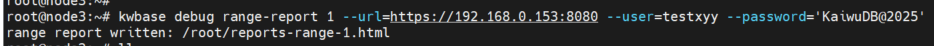
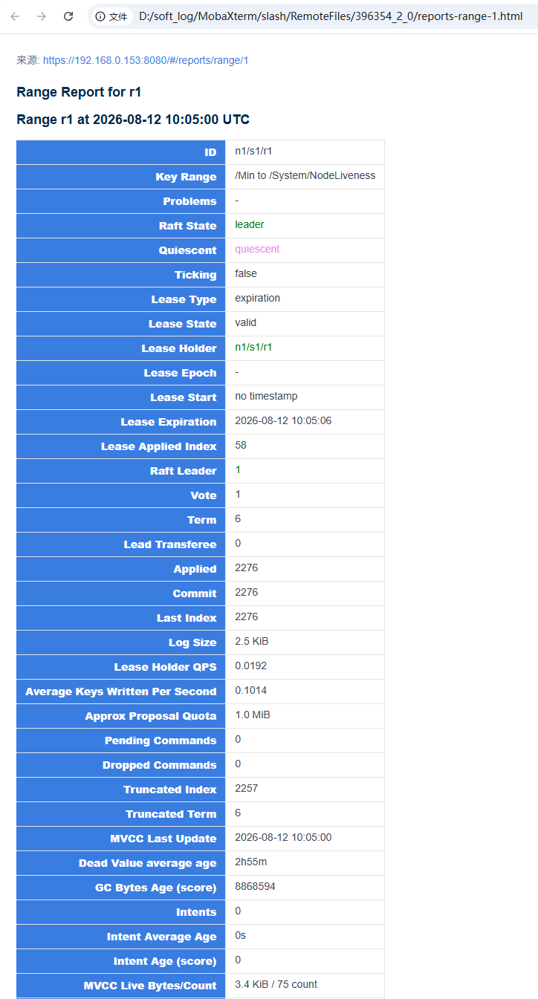
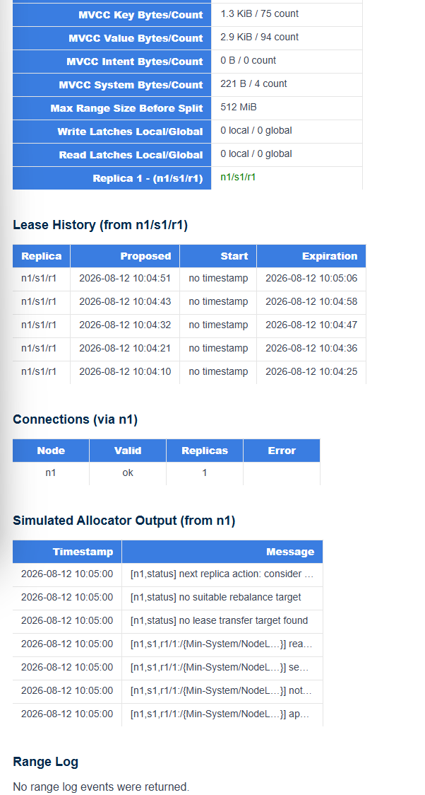
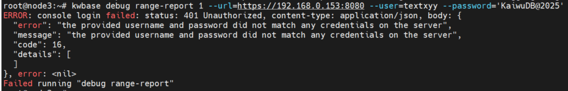
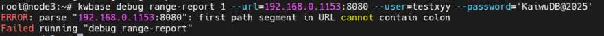
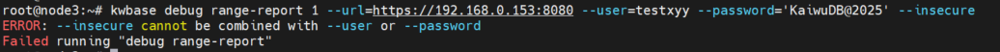
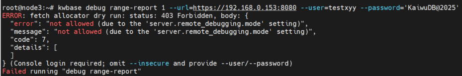

# Range报告管理

## 功能概述

KaiwuDB支持通过CLI命令获取Ranfe核心数据，并生成HTML报告查看；
    - Range状态信息
    - Allocator信息
    - Range Log事件

使用场景：
- 问题排查：当出现副本故障、lease异常等，需要快速获取该Range的完整准段报告；
- 离线分析：定期导出Range数据，便于离线分析、问题复现、知识共享；

### 所需权限

- 用户必须具有 `admin` 权限才能查看所有监控数据。

### 命令格式

```shell
kwbase debug range-report <RANGE ID> 
```

#### 参数说明

| 参数 | 说明 |
| --- | --- |
| `--url`      | KaiwuDB Console基础url，支持带hash route，如：http://{host}:{port}/#/reports/range/1，`host`：数据库服务所在服务器IP；`port`：KaiwuDB启动命令中http参数，默认`8080`。  <br >**说明**安全模式下建议使用`https`，非安全模式使用`http`||
| `--user`     | 安全认证登录用户名，具有 `admin` 或者 `sysadmin` 权限。 |
| `--password` | 安全认证登录密码。|
| `--insecure` | 数据库采用非安全模式部署，生产环境慎用。 |

### 使用示例

安全模式：

```shell
kwbase debug range-report 1 --url=https://100.150.0.12:8080 --user=testxyy --password='KaiwuDB@2025'
```

非安全模式：

```shell
kwbase debug range-report 1 --url=http://100.150.0.12:8080 --insecure
```

命令执行成功后，会在当前目录下生成 `reports-range-<id>.html `文件，可直接选择浏览器打开；







## 常见问题：

1、安全模式下校验用户密码失败



2、URL格式错误



:::说明
- 安全模式下，`--url`参数格式为 `https://host:port`；
- 非安全模式下，`--url`参数格式为 `http//host:port`；
:::

3、参数冲突



:::说明
`--user`、`--password` 和 `--insecure` 不可以同时使用，`--insecure`参数仅在以非安全模式部署的数据库情况下才可使用。
:::

4、URL地址不可达



:::说明
检查cluster setting `server.remote_debugging.mode` ，如果是`local`，修改为`any`；
:::

