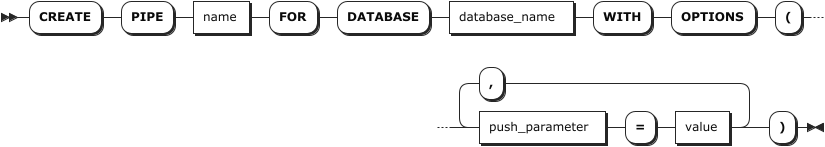
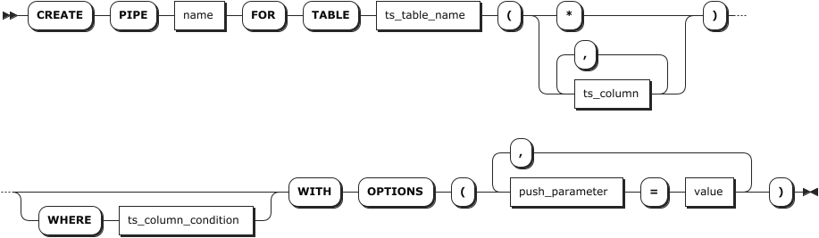
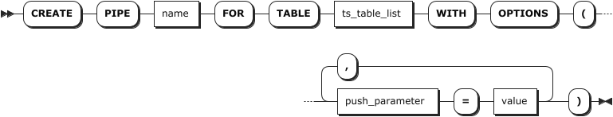
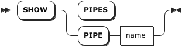
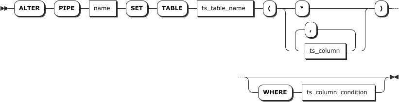
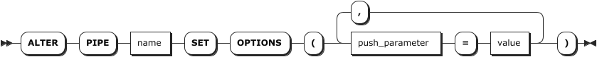
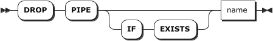

# Data Push Pipeline

## Create Pipe

The `CREATE PIPE` statement is used to create a data push pipeline.。

### Privileges

- The user must be a member of the `admin` role or have the SELECT privilege on the target table. By default, the `root` user belongs to the `admin` role.

### Syntax

- Single database push

    

- Single table push

    

- Multiple tables push

    

### Parameters

::: warning Notes

- The `database_name` parameter applies only to single-database push scenarios.
- The `ts_table_list` parameter applies only to multiple-table push scenarios.
- The `ts_table_name`、`ts_column` and `ts_column_condition` parameters apply only to single-table push scenarios.
:::

| Parameter | Description |
| --- | --- |
| `name`                | Specifies the unique name of the data push pipeline within the system. |
| `database_name`       | Specifies the name of the database to be pushed. |
| `ts_table_name`       | The name of the target time-series table. You can modify the monitored table using `ALTER PIPE <name> SET TABLE`. |
| `ts_table_list`       | The list of time-series tables for multi-table push. Multiple table names are separated by commas（`,`）.|
| `ts_column`           | The columns of the time-series table to be monitored. Supports monitoring all columns or specified columns.<br >- *: Monitors all columns.<br >- If a monitored column is deleted or renamed, the system stops monitoring and pushing data for that column.<br >- Newly added table columns will not be included in the push scope. |
| `ts_column_condition` | Optional. Specifies filter conditions for time-series data. You can update the filter conditions using  `ALTER PIPE <name> SET TABLE` .<br > - Supports filtering on data columns, Primary Tag columns, and ordinary Tag columns.<br > - Supports filtering based on timestamp column.<br > - Does not support aggregate functions, type conversion, collation rules, system column references, or non-immutable built-in functions. |
| `push_parameter`      | Data Push options。You can modify these options using `ALTER PIPE <name> SET OPTIONS` . Supported parameters are as follows：<br >- `enable`：Enables or disables the real-time data push service. Valid values: `on` / `off`. Default: `on`.<br >- `sink`：Data push target. Currently, KWDB only supports pushing data to Kafka topics. An invalid sink configuration will trigger an error.<br >- `message_format`：Data push format.Currently, only `JSON` is supported. KWDB supports pushing single or multiple records with different message types: `insert` for regular data insertion, `snapshot` for restart catch-up data, `delete` for deletion operations, and `update` for update operations.<br >- `ignore_history`： whether to skip historical data.Valid values: on / off. `on`:skips historical data.`off`:synchronizes historical data. Default: `on`.<br >- `buffer_size`：buffer size in MiB. A value of 0 sends data immediately. Default: `1`.<br >- `retrieve_tags`：Enables automatic supplementation of ordinary Tag values. Default: `on`.If ordinary Tags are not specified in output or filter columns, no supplementation is performed regardless of this setting.if ordinary Tag columns are specified but missing in new records, the system automatically fills the Tag values from previously stored records with the same Primary Tag. If the incoming Tag combination conflicts with the initial record, the initial ordinary Tag value is used for filtering.`off`:missing ordinary Tag values are treated as NULL. Conflicting incoming Tag values will override previous values for filtering.<br >- `publish`：the types of SQL operations.Supported `insert`、`update`、`delete`、`ddl` and `all` ,Default `insert`. |
| `value`               | The value of the corresponding push parameter. |

### Examples

- Single database push

    The following example creates a data push pipeline named  `benchmark_pipe` , It pushes data from the `benchmark` database to the Kafka topic `test_topic` in real time with immediate delivery enabled.

    ```sql
    CREATE PIPE benchmark_pipe FOR DATABASE benchmark WITH OPTIONS( enable = 'on', sink = 'kafka://localhost:9092?topic_name=test_topic', ignore_history = 'off', buffer_size = '0');
    ```

- Single table push

    The following example creates a data push pipeline named `ts_table_a_pipe_a` ，Filter data from the time-series table `ts_table_a` according to specified conditions and push the results to the Kafka topic `test_topic` in real time。

    ```sql
    CREATE PIPE ts_table_a_pipe_a FOR TABLE ts_table_a(*) WHERE hostname='www.example1.com' AND max_usage_user > 60 WITH OPTIONS( enable = 'on', sink = 'kafka://localhost:9092?topic_name=test_topic');
    ```

- Multiple tables push

     The following example creates a data push pipeline named `benchmark_pipe` ，Push data from the `disk` and `memory` tables in the `benchmark` database to the Kafka topic `test_topic` in real time with immediate delivery enabled.

    ```sql
    CREATE PIPE benchmark_pipe FOR TABLE benchmark.disk, benchmark.memory WITH OPTIONS( enable = 'on', sink = 'kafka://localhost:9092?topic_name=test_topic', ignore_history = 'off', buffer_size = '0');
    ```

## Show Pipe

The `SHOW PIPES` or `SHOW PIPE` statement is used to view information about all or specified data push pipelines, including pipeline name, target time-series tables, configuration parameters, creation time, creator, current status, start time, end time and failure causes.

### Privileges

None

### Syntax



### Parameters

| Parameter | Description |
|--------|---------------------------|
| `name` | The name of the data push pipeline |

### Response Fields

| Field           | Description                                        |
|-----------------|-------------------------------------------|
| `name`          | The unique name of the data push pipeline within the system.   |
| `table_name`    | The name of the target time-series table for the data push service.      |
| `column_names`  | Target columns of the data push service.                      |
| `filter`        | Filter conditions applied to the data push service.                    |
| `sink`          | Destination of the data push service pipeline.                  |
| `low_watermark` | Replication checkpoint of the data push service.                     |
| `status`        | Whether the real-time data push service is enabled.                |
| `create_at`     | The time when the data push pipelineis created.                 |
| `start_time`    | The time when the data push pipelineis created. |
| `create_by`     | The Creator of the data push pipeline.                       |
| `end_time`      | The last time to stop the data push pipeline. By default, it is kept empty.          |
| `error_message` | The error message for a stream ata push.                     |

### Examples

This example lists details of the  `ts_table_a_pipe_a`.

```sql
SHOW PIPE ts_table_a_pipe_a;
```

If you succeed, you should see an output similar to the following:

```sql
     name    |        table_name        |     column_names     |  filter   |                       sink                        |    low_watermark     | status |            create_at             | create_by |        start_time         | end_time | error_message
-------------+--------------------------+----------------------+-----------+---------------------------------------------------+----------------------+--------+----------------------------------+-----------+---------------------------+----------+----------------
  ts_table_a_pipe_a | test_data_pipe.public.ts_table_a | k_timestamp,id,code1 | code1 = 3 | kafka://localhost:9092?topic_name=test_topic2 | 1717632000000 | Enable | 2025-02-17 01:41:42.135389+00:00 | root      | 2025-02-17 01:41:42+00:00 | NULL     |
(1 row)
```

## Alter Data Push Pipe

The `ALTER PIPE` statement modifies existing data push pipelines. It includes two subcommands: 

- `ALTER PIPE SET TABLE`：Modifies the target time-series table, output columns and filter conditions of a data push pipeline.
- `ALTER PIPE SET OPTIONS`：Adjusts push parameters and destinations, and starts or stops the data push service.

::: warning Notes

- The `ALTER PIPE SET TABLE` and `ALTER PIPE SET OPTIONS` must be used separately. KWDB does not support modifying the target table and push parameters in a single statement.
- For single-database and multi-table push pipelines, renaming the time-series database or tables is not allowed.
:::

### Privileges

- The user must be a member of the `admin` role or the creator of the stream. By default, the `root` user belongs to the `admin` role.

::: warning Notes
If the user who created a data push pipeline is removed, only the `admin` role can modify the specified data push pipeline.
:::

### Syntax

- Modifies the target time-series table, output columns and filter conditions of a data push pipeline.

    

- Adjusts push parameters 

    

### Parameters

::: warning Notes
The `ts_table_name`、`ts_column` and `ts_column_condition` parameters apply only to single-table push scenarios.
:::

| Parameter | Description |
| --- | --- |
| `name`                | The name of the data push pipeline. |
| `ts_table_name`       | The name of the time-series table. |
| `ts_column` | The columns of the time-series table to be monitored. Supports monitoring all or partial columns of the target time-series table.<br >- *：Monitor all columns<br >- If a monitored column is deleted or renamed, the system stops monitoring and pushing data for that column.<br >- It is allowed to add columns,but they will not be included in the push scope. |
| `ts_column_condition` | Optional. Specifies filter conditions for time-series data. <br >- Supports filtering on data columns, Primary Tag columns, and ordinary Tag columns.<br >- Supports filtering based on timestamp column.<br > - Does not support aggregate functions, type conversion, collation rules, system column references, or non-immutable built-in functions. |
| `push_parameter`      | Data Push options. Supported parameters are as follows：<br >- `enable`：Enables or disables the real-time data push service. Valid values: `on` / `off`. Default: `on`.<br >- `sink`：Data push target. Currently, KWDB only supports pushing data to Kafka topics. An invalid sink configuration will trigger an error.<br >- `message_format`：Data push format.Currently, only `JSON` is supported. KWDB supports pushing single or multiple records with different message types: `insert` for regular data insertion, `snapshot` for restart catch-up data, `delete` for deletion operations, and `update` for update operations.<br >- `ignore_history`： whether to skip historical data.Valid values: on / off. `on`:skips historical data.`off`:synchronizes historical data. Default: `on`.<br >- `buffer_size`：buffer size in MiB. A value of 0 sends data immediately. Default: `1`.<br >- `retrieve_tags`：Enables automatic supplementation of ordinary Tag values. Default: `on`.If ordinary Tags are not specified in output or filter columns, no supplementation is performed regardless of this setting.if ordinary Tag columns are specified but missing in new records, the system automatically fills the Tag values from previously stored records with the same Primary Tag. If the incoming Tag combination conflicts with the initial record, the initial ordinary Tag value is used for filtering.`off`:missing ordinary Tag values are treated as NULL. Conflicting incoming Tag values will override previous values for filtering.<br >- `publish`：the types of SQL operations.Supported `insert`、`update`、`delete`、`ddl` and `all` ,Default `insert`.  <br > **Note** <br >Currently, only the enable parameter can be modified online. To modify other parameters, stop the real-time data push service first.|

### Examples

- Modify filter condition of a data push pipeline

    The following example modifies the filter condition of the `ts_table_a_pipe_a` ,setting `max_usage_user > 50`.

    ```sql
    ALTER PIPE ts_table_a_pipe_a SET TABLE ts_table_a(*) WHERE hostname='www.example1.com' AND max_usage_user > 50;
    ```

- Modify push parameter of a data push pipeline

    The following example modifies the push parameter，stop the data push pipeline `ts_table_a_pipe` .

    ```sql
    -- stop PIPE
    ALTER PIPE ts_table_a_pipe_a SET OPTIONS (enable = 'off');
    ```

    You can also modify push parameter using `ALTER PIPE <name> SET <push_parameter> = '<value>'` .

    ```sql
    -- stop PIPE
    ALTER PIPE ts_table_a_pipe_a SET enable = 'off';
    ```

## Drop Data Push Pipe

The `DROP PIPE` statement is used to delete a specified data push pipeline. If data push is in progress, the pipeline will be deleted only after the ongoing push completes.

### Privileges

-  The user must be a member of the `admin` role or the creator of the stream. By default, the `root` user belongs to the `admin` role.

::: warning Notes
If the user who created a data push pipeline is removed, only the `admin` role can modify the specified data push pipeline.
:::

### Syntax



### Parameters

| Parameter | Description |
| --- | --- |
| `IF EXISTS` | Optional keyword. When specified, the pipeline will be deleted if it exists. No error will be thrown if the pipeline does not exist. Without this keyword, an error will be returned if the target pipeline cannot be found. |
| `name`      | The name of the data push pipeline. |

### Examples

The following example deletes the data push pipeline named `ts_table_a_pipe_a`.

```sql
DROP PIPE ts_table_a_pipe_a;
```
