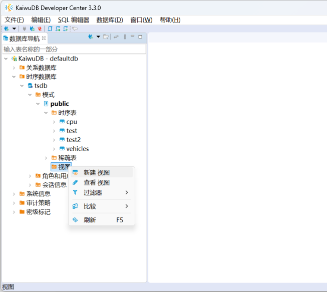
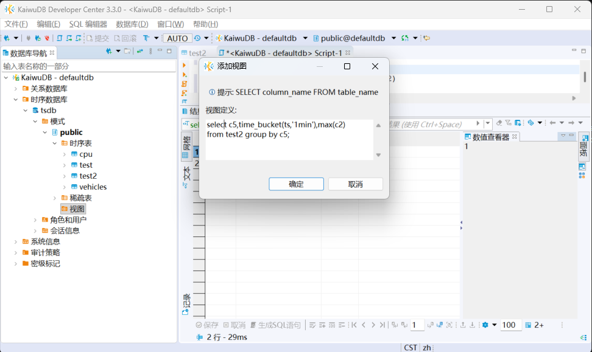
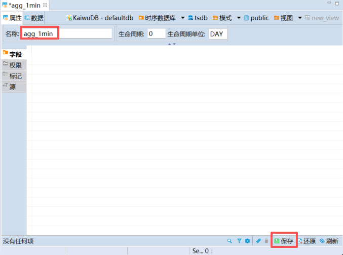
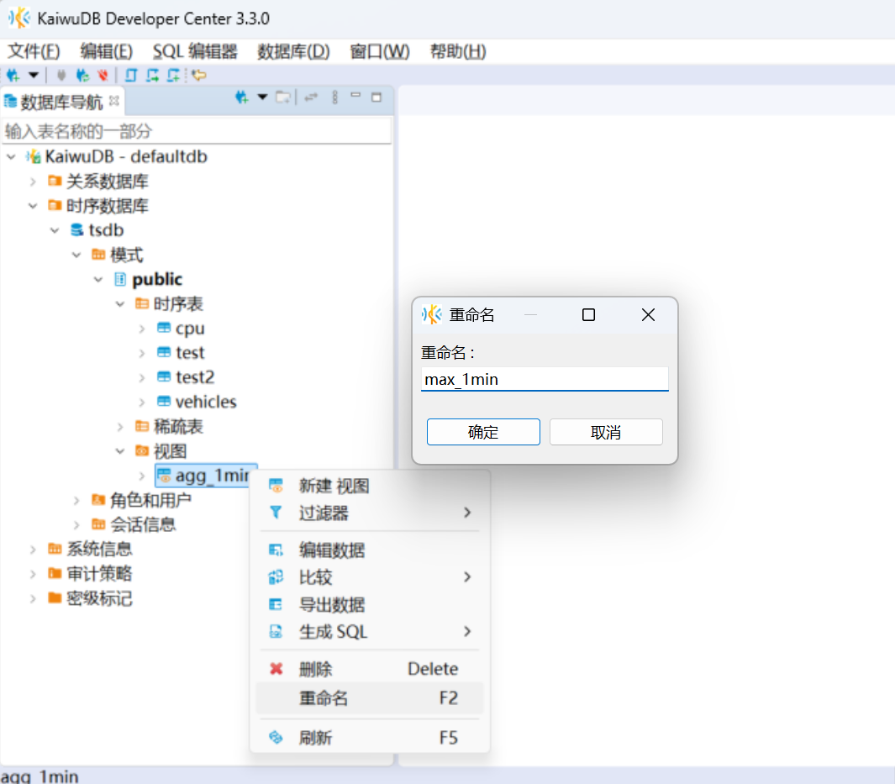
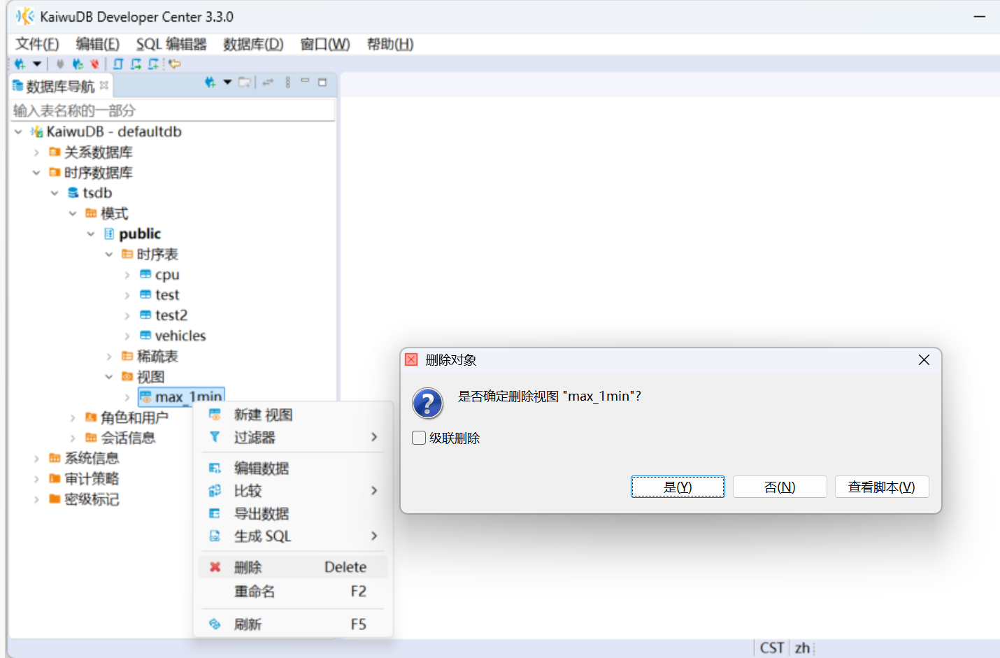
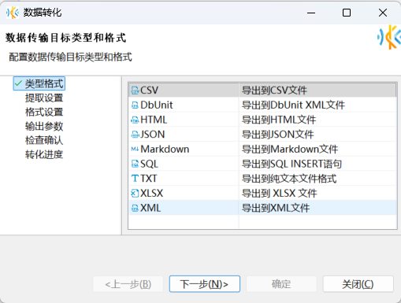
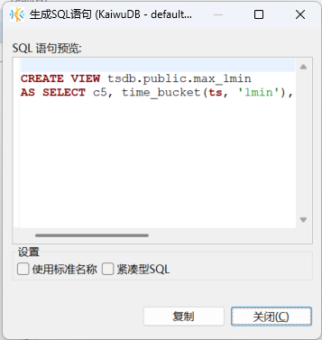

# 视图管理

KWDB 开发者中心支持创建、编辑、删除、重命名视图、从视图中读取数据，以及为视图生成 SQL 语句。

## 创建视图

### 前提条件

用户是 `admin` 角色的成员或者拥有所属数据库 CREATE 权限和引用表的 SELECT 权限。默认情况下，`root` 用户属于 `admin` 角色。

### 步骤  

如需创建新的视图，遵循以下步骤：

1. 在数据库导航区，右键单击指定数据库模式下的视图，然后选择**新建视图**。

    

2. 在**添加视图**对话框，写入想要查询的 SQL 语句，然后单击**确定**。

    

3. 在新视图的**属性**页签，修改视图名称，然后单击页面右下方的保存按钮。

    

4. 在**执行修改**窗口，确认 SQL 语句无误，然后单击**执行**。

## 重命名视图

### 前提条件

用户是 `admin` 角色的成员或者拥有重命名前视图的 DROP 权限以及重命名后视图所属数据库的 CREATE 权限。默认情况下，`root` 用户属于 `admin` 角色。

### 步骤

如需重命名视图，遵循以下步骤：

- 视图属性页修改

    1. 在数据库导航区，右键单击需要编辑的视图，然后选择**编辑数据**。
    2. 在**属性**页面，修改视图名称。
    3. 单击页面右下方的保存按钮。

- 数据库导航区修改

    1. 在数据库导航区，右键单击需要重命名的视图，然后选择**重命名**。
    2. 在**重命名**窗口，编辑视图名称，然后单击**确定**。

        

    3. 单击页面右下方的确认按钮。
    4. 在**执行修改**窗口，确认 SQL 语句无误，然后单击**执行**。

## 删除视图

### 前提条件

- 删除无依赖的视图：用户是 `admin` 角色的成员或者拥有目标视图的 DROP 权限。默认情况下，`root` 用户属于 `admin` 角色。
- 删除存在依赖的视图：用户是 `admin` 角色的成员或者拥有目标视图的 DROP 权限及其关联对象的 DROP 权限，默认情况下，`root` 用户属于 `admin` 角色。

### 步骤

如需删除视图，遵循以下步骤。

1. 在数据库导航区，右键单击需要删除的视图，然后选择**删除**。
2. 在**删除对象**窗口，单击**是**删除当前视图;也可点击**否**取消删除操作；也可点击**查看脚本**查看具体执行的SQL语句。

    

## 导出数据

### 前提条件

- 用户是 `admin` 角色的成员或者拥有所属数据库的导出权限和引用表的 SELECT 权限。默认情况下，`root` 用户属于 `admin` 角色。

### 步骤

如需导出视图数据，遵循以下步骤。
1. 在数据库导航区，右键单击需要导出数据的视图，然后选择**导出数据**，进入**数据转化**窗口，按页面指引完成数据导出。

    

## 生成 SQL 语句

如需为视图生成 SQL 语句，遵循以下步骤。

1. 在数据库导航区，右键单击需要生成 SQL 语句的视图，选择**生成 SQL**，然后选择需要生成的 SQL 语句类型（`DDL`、`SELECT`）。
2. 在**生成 SQL 语句**窗口，选择是否**使用标准名称**和**紧凑型 SQL**，然后单击**复制**或**关闭**。

    

    默认情况下，使用标准名称，不使用紧凑型 SQL。

