# KIP 用户界面

KIP 主界面采用侧边栏导航设计，分为两大大部分：

- 左侧导航栏：提供**工作台**、**AI分析**、**数据空间**、**洞察**、**自动化**、**设置**、**系统信息** 7 个主要页面的入口。
    - 工作台：展示**数据资产**、**AI洞察**、**智能任务**列表，提供**对话框**，用一句话开启新的数据分析；
    - AI 分析：包含**对话**和**技能·工具**，配置 skill 工具、提示词、MCP Server，用自然语言的形式开启数据分析；
    - 数据空间：包含**数据源**、**语义信息**，进行数据源配置管理和语义信息生成，接入时序数据，赋予数据对象业务信息；
    - 洞察：包含**仪表板**和**图表库**，进行数据分析结果展示；
    - 自动化：包含**智能任务**和**执行记录**，包含 Agent 任务、仪表板解读、异常告警三种任务的配置和执行记录展示；
    - 设置：包含基本设置（语言、主题）、模型、通知的配置；
    - 系统信息：查看版本构建信息、引导重看；

- 中央内容区域：根据选择的左侧导航项显示对应页面。

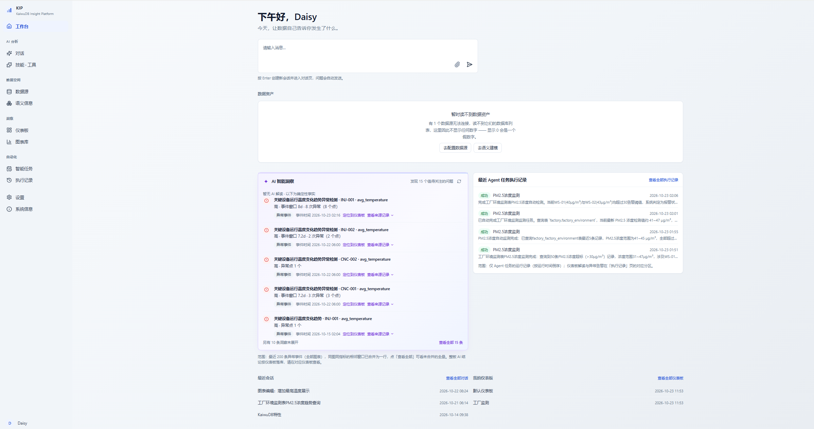

使用 KIP 进行数据分析与洞察之前，必须先配置数据源、LLM 模型，否则只能在**AI 分析**子模块**对话**中进行 KaiwuDB 基本知识问答，比如 KaiwuDB 特性、支持的语法等等。

## 用户管理

KIP 使用 KaiwuDB 官网账户进行身份认证和权限管理，支持账户登录与登出功能。当使用已注册的 KaiwuDB 账户登录后，用户可以使用 KIP 的全部功能。退出后，用户无法进行任何提问或系统配置操作，需重新登录方可使用。同时，KIP 支持多用户数据隔离，当前登录用户仅可查看自己的对话历史、数据源、仪表板等信息，确保用户数据的隐私和安全

::: warning
为避免账号间相互冲突，如需在同一台电脑上登录多个 KIP 账户，确保每次登录使用独立的浏览器环境。用户可以采取以下任一操作：

- 使用不同浏览器：例如，在一个浏览器中（例如 Chrome）登录一个账号，在另一个浏览器中（例如 Firefox）登录另一个账号。
- 使用同一浏览器的隐私模式：在常规窗口中登录一个账号，在无痕窗口中（Chrome 浏览器）或隐私窗口中（Firefox 浏览器）​ 登录另一个账号。
:::

## 设置

KIP 设置页面包含基本设置、模型、通知三个配置项。

### 基本设置

进行语言、主题的设置，语言包含中文和 English 两种；主题包含明亮和黑暗两种；语言和主题设置后立即生效，但只对当前浏览器生效，当在其他浏览器上打开时恢复为默认状态。

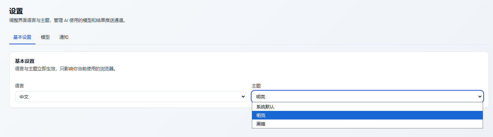

### 模型

KIP 中大部分 AI 功能——对话式分析、语义构建、数据解读、智能推荐、趋势预测、异常检测等都需要借助外部大语言模型（LLM）支撑，因此在使用 KIP 其他功能前需要先进行模型配置。
- 支持添加、修改、删除、连接测试模型；
- 支持模型的启用和禁用，在对话界面，仅展示开启的模型名称列表。

#### 添加模型

如需添加模型，遵循以下步骤。

1. 在左侧导航栏单击**设置**，选择**模型**页签。

2. 单击*添加配置*。在弹出的对话框中，添加模型信息。

    - `名称`：自定义模型名称。
    - `模型供应商`：模型供应商的名称。支持 **Qwen**、**DeepSeek**、**字节豆包**、**Kimi**、**MiniMax**、**智谱 GLM** 和**自定义**选项。默认为 **自定义**。
    - `模型名称`：模型 ID，必须和 API 服务商保持一致。
    - `API Key`：模型的 API 密钥，在模型供应商平台申请，用于鉴权。
    - `API URL`：模型的 API 基础 URL。
    - `Temperature`：模型的温度参数，取值 0~1。`0` 最确定、重复性强，适合代码、数据提取；数值越高，回答越有创意、随机性越强。
    - `最大 Token`：单次对话允许消耗的 token 上限，包含用户输入 + 模型输出。
    - `思考模式`：`思考预算`、`推理强度`、`保留思考`是否展示取决于所选`模型供应商`，不是全部都支持。
      - `思考模式`：是否启用思考模型。该参数只适用于已配置思考模型的模型供应商。
      - `思考预算`：思考模型使用的思考预算。
      - `推理强度`：思考模型的推理强度。该参数的可选项因模型不同而不同。
      - `保留思考`：思考是否保留。提供`全部保留`、`不保留`两个选项。
    
    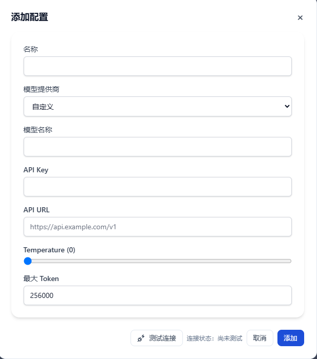

    模型信息配置完成后，可点击右下角的*连接测试*验证模型连通性。

3. 单击*添加*。

::: tip
语义构建、智能推荐等功能默认使用设置为*默认*的 LLM 模型，如果手动未设置，则使用最近添加的启用的 LLM 模型；
:::

#### 修改模型

如需修改模型配置，遵循以下步骤。

1. 在左侧导航栏单击**设置**，选择**模型**页签。

2. 单击指定模型对应的编辑图标。

3. 在弹出的对话框中修改模型的配置信息。有关模型的配置信息，参见[添加模型](#添加模型)。

4. 单击*保存*。

#### 关闭模型

KIP 提供两种关闭模型的方式：（1）禁用；（2）删除

如需禁用，进入**设置**选择**模型**页签，点击对应模型右上角的小圆圈按钮禁用。

如需删除，进入**设置**，选择**模型**页签，单击对应模型右下角的删除按钮。在弹出的对话框中，点击*确定*。

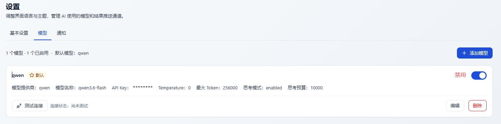

### 通知

KIP 的智能任务仪表板解读、异常告警、Agent任务、报告定期推送等都通过**通知**对接至第三方系统。
- KIP 支持添加、修改、删除通知。
- 支持 Webhook 和 MQTT 两种通知方式，当配置的触发事件发生时，KIP 自动将对应订阅的内容发送至对应地址，以便第三方应用可以接收数据。

#### 添加通知

如需添加通知，遵循以下步骤。

1. 在左侧导航栏单击**设置**，选择**通知**页签。
2. 单击*添加通知*。在弹出的对话框中，自定义通知。

    webhook 类型：

    - `名称`：通知的名称。
    - `通知类型`：Webhook。
    - `Webhook URL`：通知接收方的 URL 地址。
    - `目标地址`：通知接收方的 Webhook 地址。
    - `Webhook Header`：Webhook 请求头部。
    - `消息格式`：通知的格式。

    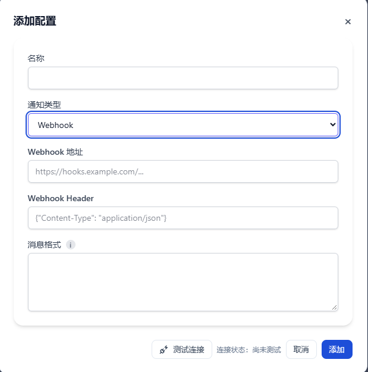

    MQTT 类型：
    - `名称`：通知的名称。
    - `通知类型`：MQTT 。
    - `MQTT Broker`：MQTT 服务的地址，远程服务器需要填写对应服务器的 IP 或者域名。
    - `MQTT 端口`：MQTT 服务端口：<br >- 1883：非加密 TCP 默认端口。<br >- 8883：TLS 加密安全端口。
    - `MQTT Topic`：消息发布的主题，支持/分层。
    - `MQTT 用户名`：MQTT 服务认证账号，服务开启账号密码校验时填写；无认证可留空。
    - `MQTT 密码`：MQTT 服务认证密码，对应上面用户名，无认证可留空。
    - `MQTT QoS`：消息服务质量等级：<br >`0`：最多一次（消息发出去就不管，可能丢消息，速度最快）。<br >`1`：至少一次（保证送达，但可能重复收到）。<br >`2`：恰好一次（不丢不重复，开销最大）。
    - `消息格式`：自定义推送消息的内容模板，一般支持变量占位符。

    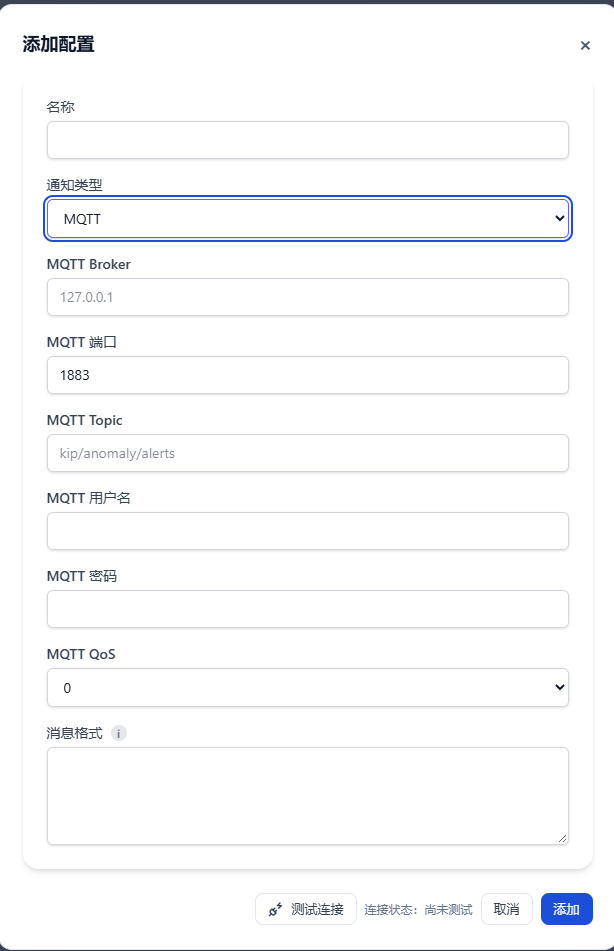

    通知信息配置完成后，可点击右下角的*连接测试*验证通知配置连通性。

3. 单击*添加*。

#### 修改通知

如需修改通知，遵循以下步骤。

1. 在左侧导航栏单击**设置**，选择**通知**页签。
2. 单击指定通知对应的编辑图标。
3. 在弹出的对话框中修改通知的配置信息。有关通知的配置信息，参见[添加通知](#添加通知)。
4. 单击*保存*。

#### 删除通知

如需删除通知，遵循以下步骤。

1. 在左侧导航栏单击**设置**，选择**通知**页签。
2. 单击指定通知对应的删除图标。
3. 在弹出的对话框中，单击*确定*。

## 系统信息

首次登陆 KIP 后，提供引导信息，一步一步教用户如何使用 KIP，如果点击跳过想重新查看时，就可以点击左侧导航栏单击**系统信息**，再点击右上角的*重看引导*。

## 数据空间

### 数据源

进行数据分析之前得先有数据，KIP 支持添加、修改和删除数据库源。
- KIP 1.0 支持的数据源包含KaiwuDB/KWDB。
- 支持数据库配置的启用和禁用，在对话界面，仅展示开启的数据配置名称列表。

#### 添加数据源

如需添加数据库连接信息，遵循以下步骤。

1. 在左侧导航栏**数据空间**下单击**数据源**。

2. 单击**添加数据源**。在弹出的对话框中，添加数据库信息。

    - `名称`：数据库的连接名称。
    - `主机名/IP 地址`：KaiwuDB 数据库所在主机的 IP 地址。
    - `端口`：KaiwuDB 数据库的连接端口，默认 `26257`。
    - `管理端口`：数据库监控平台 AdminUI 的服务端口。
    - `用户名`：KaiwuDB 数据库的登录用户名。
    - `密码`：KaiwuDB 数据库的登录密码，非安全模式部署时无需填写。
    - `数据库`：待连接的数据库名称，默认为 `defaultdb`。
    - `SSL 证书配置`：可选参数，使用证书登录数据库时，需配置客户端证书、私钥和 CA 证书。
    - `超时时间`：设置数据库连接的超时时间（单位：秒）。默认为 `30s`。
    - `启用数据库`：是否启用该数据库连接。勾选后，系统启用该数据库。

    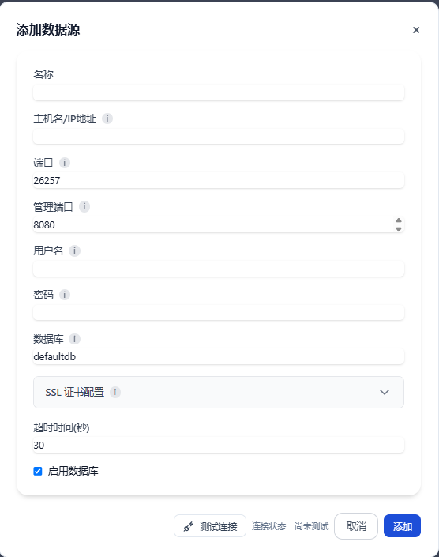

    数据源配置完成后，可点击右下角的*连接测试*验证数据源连通性。

3. 单击**添加**。

添加数据源后，可点击数据源下方的**查看语义**或者**数据空间**下单击**语义信息**进行语义模型的初始化。

#### 修改数据库配置

如需修改数据库配置，遵循以下步骤。

1. 在左侧导航栏**数据空间**下单击**数据源**。
2. 单击指定数据库对应的编辑图标。
3. 在弹出的对话框中修改数据库的配置信息。有关数据库的配置信息，参见[添加数据库](#添加数据源)。
4. 单击**保存**。

#### 关闭数据源

KIP 提供两种关闭数据源的方式：（1）禁用；（2）删除

如需禁用，在左侧导航栏**数据空间**下单击**数据源**，点击对应数据源右上角的小圆圈按钮禁用。

如需删除，在左侧导航栏**数据空间**下单击**数据源**，单击对应数据源右下角的删除按钮。在弹出的对话框中，点击**确定**。

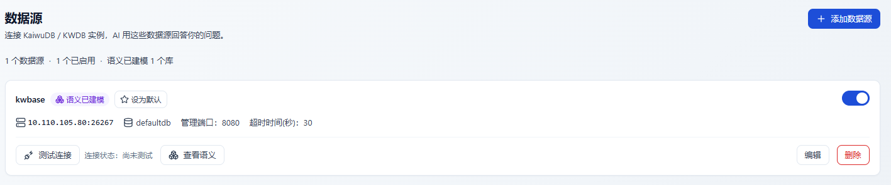


### 数据语义

赋予数据源中的对象、数值含义、业务定义，让 AI 不只看懂字符串、数字，还能理解 “数据代表什么”。

#### 语义模型初始化

在左侧导航栏**数据空间**下单击**语义信息**，包含两个页签，两个页签均支持*初始化语义模型*
- *语义视图*：已配置数据源下的用户对应权限下的数据库对象；
- *元数据视图*：以列表形式展示每个库下存在的表以及每张表的列信息。

初始化前：

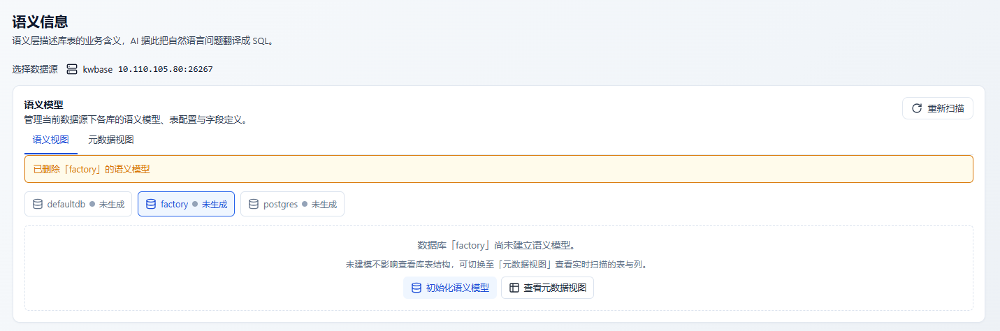

初始化后：

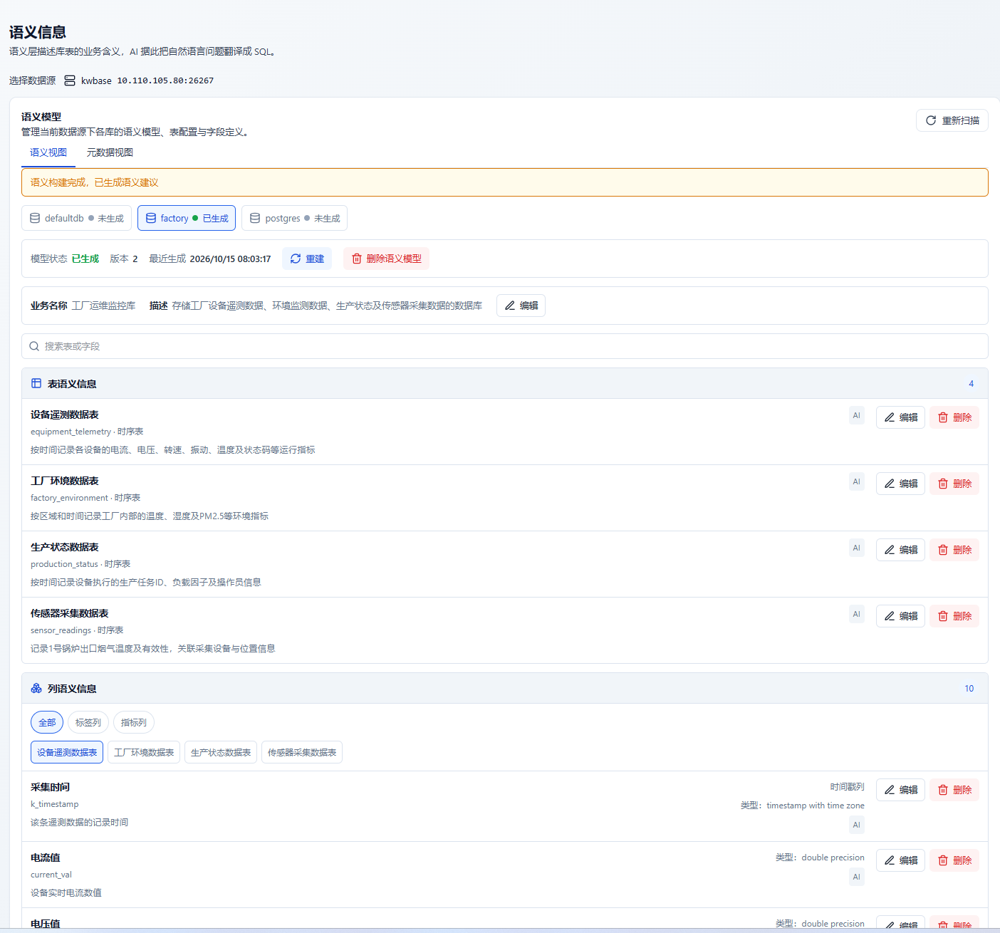

在*语义视图*页签最下方，支持查看**语义模型**的构建历史记录。

#### 编辑语义信息

初始化语义信息是系统自动完成的，如果部分信息偏离实际业务场景，可点击库/表/列右侧的编辑按钮，人工进行修改校准。

#### 重建/删除语义信息

初始化语义信息构建成功后，支持重建或者删除语义模型。重建时，会保留之前人工维护过的信息，未维护过的对象语义采用系统自动生成的。

#### 重新扫描/刷新

当已配置数据源新增库/表/列对象之后，系统不会自动刷新语义信息页面，且不会自动为新增对象构建语义模型，因此KIP提供重新扫描/刷新按钮进行手动更新，更新后，在点击*重建*进行语义模型的重新构建。
- 重新扫描：面向的对象是整个数据源；
- 刷新：面向的是所选数据源下某一选中数据库；

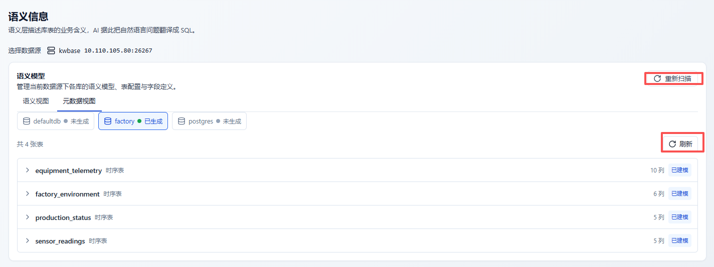

## AI 分析

### 对话

KIP 支持在对话中以自然语言的方式与 AI 对话，支持 KaiwuDB 功能特性、SQL语法、周边生态的知识问答，也可基于配置的数据源进行对话式分析。同时支持上传附件进行附加内容解析问答。

#### 新建对话

1. 在左侧导航栏单击**AI 分析**下的**对话**。

2. 在**对话列表**区域，单击*新对话*。

3. 在右侧消息交互页面，根据需要选择语言、LLM 模型、数据库和提示词（需提前配置后方可选择），输入要查询的内容，回车或者单击*发送*按钮进入交互过程。

    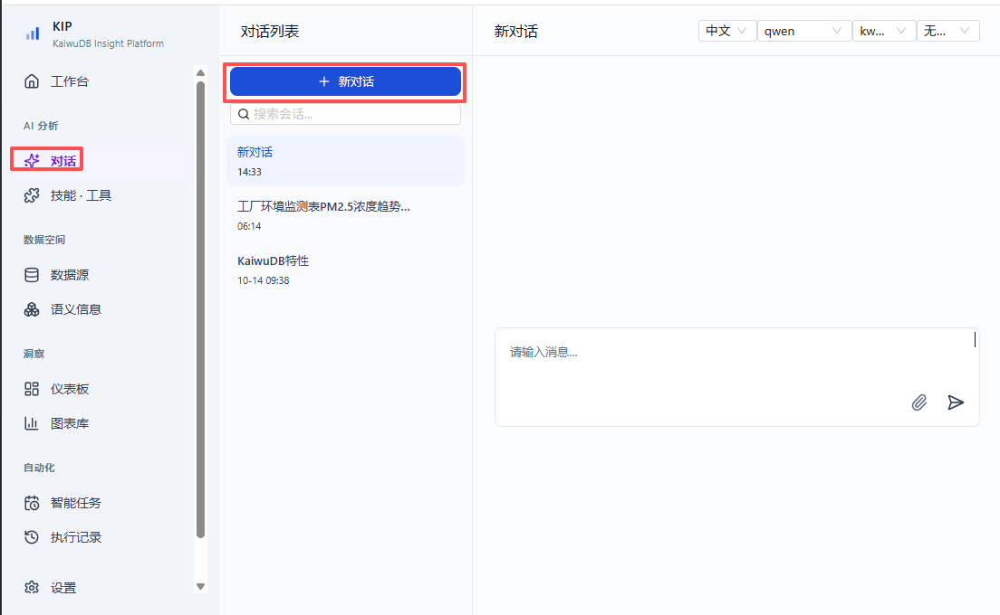

#### 查看对话

已创建的对话自动保存在**对话列表**区域，单击任意历史对话即可查看该对话的完整对话记录和配置信息。  

#### 分享对话

1. 在左侧导航栏单击**对话**。
2. 在**对话列表**区域，鼠标悬浮在目标历史对话，单击最右侧的三个点图标，从下拉菜单中选择*分享*选项。系统会将该对话的对话内容导出为 Markdown 格式并自动复制到剪贴板，粘贴后即可分享。

#### 重命名对话

提供两种重命名对话名称的方式：
- 第一种操作步骤：
    1. 在左侧导航栏单击**对话**。
    2. 在**对话列表**区域，鼠标悬浮在目标历史对话，单击最右侧的三个点图标，从下拉菜单中选择*重命名*选项，更改对话名称。
- 第二种操作方式：用户也可以直接双击对话名称进行重命名。

#### 删除对话

KIP 支持删除单个和批量删除多个对话。删除操作是不可逆操作，请谨慎操作。

##### 删除单个对话

1. 在左侧导航栏单击**对话**。
2. 在**对话列表**区域，鼠标悬浮在目标历史对话，单击最右侧的三个点图标，从下拉菜单中选择*删除*选项。
3. 在弹出的对话框中，单击*确定*。

##### 批量删除对话

1. 在左侧导航栏单击**对话**。
2. 在**对话列表**区域，鼠标悬浮在目标历史对话，单击最右侧的三个点图标，从下拉菜单中选择*多选*选项。
3. 勾选需要删除的历史对话。如需全部选中，单击*全选*。
4. 单击*删除*。
5. 在弹出的对话框中，单击*确定*。

#### 对话内消息操作

##### 复制

对话内的问和答下面均有*复制*按钮，以 Markdown 格式复制的内容，可以自主选择如何处理复制的内容。

##### 编辑

编辑功能针对问题，点击问题下面的*编辑*按钮，会自动将问题 copy 至提问框，对问题重新编辑修改后再次提问。

##### 多选

点击任意一条消息下面的*选择*按钮，可以对对话内的消息进行多选/全选，选择后，可以进行*分享*。

##### 分享

分享分为两种，一种是单条消息下面的*分享*按钮，将选中内容导出为 Markdown 格式并自动复制到剪贴板。

另外一种是基于*选择*按钮选中的多条信息的分享，支持分享和分享为图片两种方式。
- 分享是将选中内容导出为 Markdown 格式并自动复制到剪贴板。
- 分享为图片支持下载为本地图片，也可复制到剪切板。

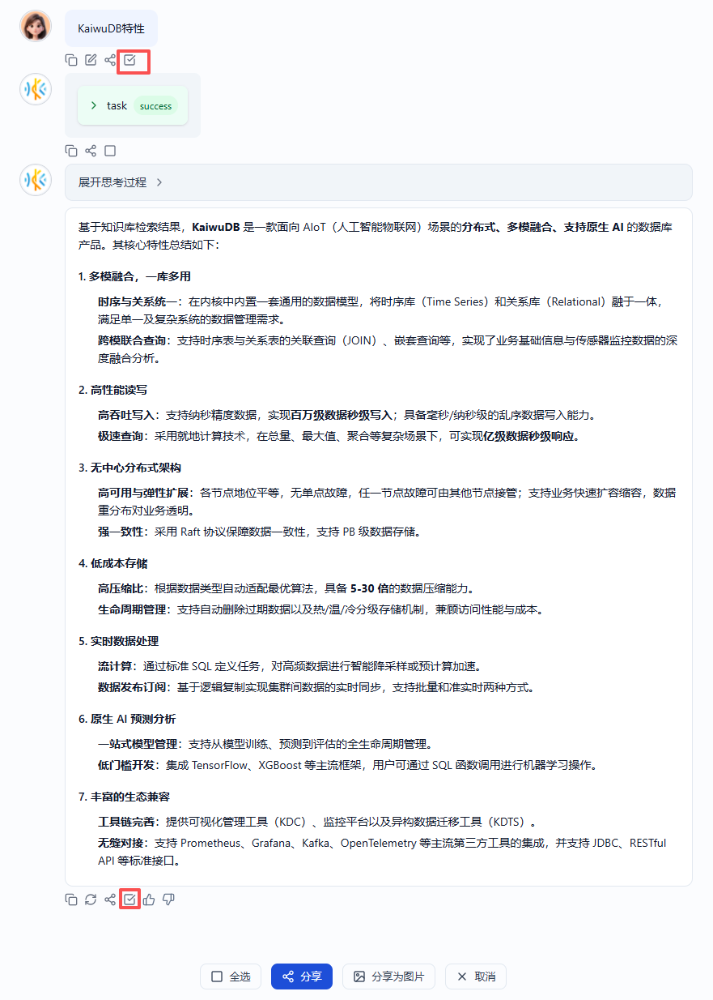

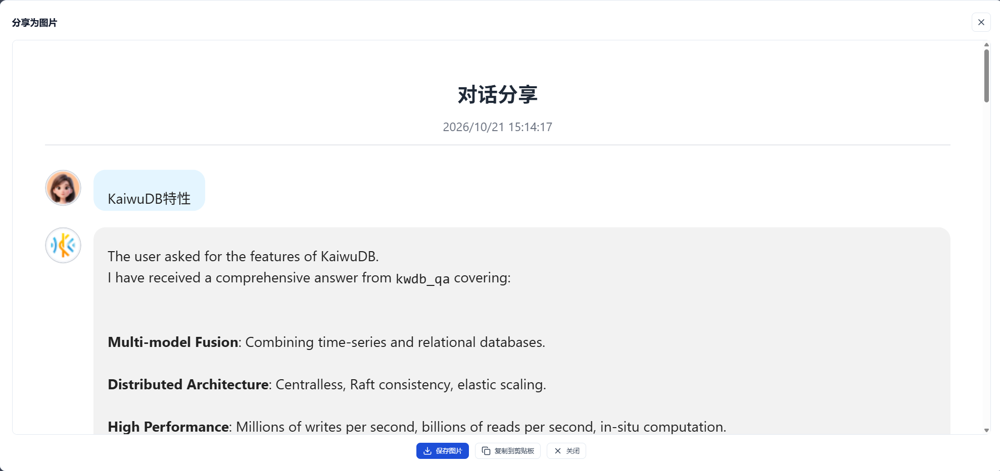

##### 对话式分析

通过自然语言方式与数据交互，KIP 内置多类标准图表模板，覆盖时序趋势、分类对比、占比分析、多维评估等主流可视化场景：

1. **折线图**：适用于时序数据趋势分析（如气温、流量、指标走势）；
2. **柱状图**：适用于分类数据对比、同维度数值差异分析；
3. **面积图**：适用于时序数据体量变化、区间趋势展示；
4. **饼图**：适用于分类数据占比统计（如业务占比、资源分配比例）；
5. **漏斗图**：适用于流程转化、层级数据统计；
6. **玫瑰图**：适用于多维度分类数据对比展示；
7. **散点图**：适用于双维度数据关联性分析；
8. **雷达图**：适用于多指标综合能力对比、多维评估场景。

支持的功能如下：
| 功能 | 说明 |
| ---- | ---- |
| 图表转换     | 将图表转换为表格，表格数据展示在图表下方，再次点击按钮，取消表格数据展示。|
| 切换类型     | 根据数据特性，自动匹配最优图表。同时提供可转换的图表类型进行切换。|
| 放大展示     | 可以将图片放大查看，更清晰的查看图表的指标数据。|
| 导出        | 支持将查询分析结果导出为 PNG、JPEG、CSV、EXCEL多种方式。|
| 添加至仪表板 | 如果想长期观测数据分析结果，可将图表添加至指定仪表板进行管理。|

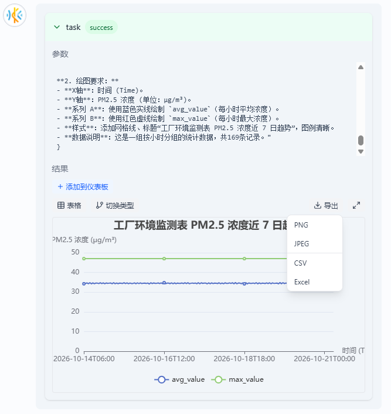

##### 添加至仪表板

会话产生的图表支持添加至仪表板，支持添加至当前已有的多个仪表板，同时也支持添加至新建仪表板。

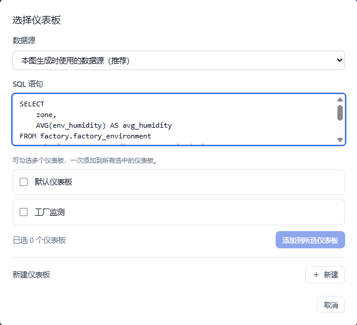

##### 问答推荐

根据历史对话信息，提供问题建议，可直接点击进行提问。

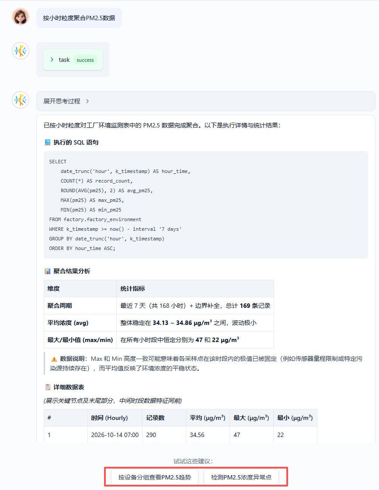

### 技能·工具

#### 技能

KIP 支持上传 zip 技能包，赋予 AI 领域能力、业务知识、固定工作流，在对话时按需加载。

#### 提示词

提示词是一种自然语言指令，它为 LLM 提供任务指导。模型会根据提示词产生相应的输出。通过配置提示词可以引导模型理解用户的具体需求，并生成更准确和高质量的输出，确保模型的响应能够满足用户在不同场景下的应用需求。

KIP 支持添加、修改、删除、导入和导出提示词。

##### 添加提示词

如需添加自定义提示词，遵循以下步骤。

1. 在左侧导航栏单击**技能·工具**，选择**提示词**页签。
2. 单击**添加配置**。在弹出的对话框中，自定义提示词。

    - `名称`：提示词的名称。。
    - `内容`：提示词的具体内容。
    - `角色`：创建提示词的角色。支持 **system**、**user**、**assistant** 三个选项。默认为 **system** 选项。
    - `版本`：提示词的版本。
    - `作者`：创建提示词的作者。

    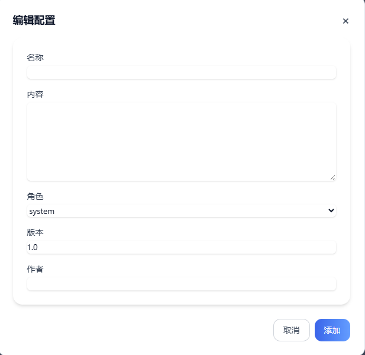

3. 单击**添加**。

##### 修改提示词

如需修改提示词，遵循以下步骤。

1. 在左侧导航栏单击**技能·工具**，选择**提示词**页签。
2. 单击指定提示词对应的编辑图标。
3. 在弹出的对话框中修改提示词的配置信息。有关提示词的配置信息，参见[添加提示词](#添加提示词)。
4. 单击**保存**。

##### 删除提示词

如需删除提示词，遵循以下步骤。

1. 在左侧导航栏单击**技能·工具**，选择**提示词**页签。
2. 单击指定提示词对应的删除图标。
3. 在弹出的对话框中，单击**确定**。

#### 工具（MCP Server）

KIP 支持添加、修改、删除、导入和导出 MCP Server 配置。

##### 添加 MCP Server

默认情况下，KIP 集成 KWDB MCP Server。如需添加其他 MCP Server，遵循以下步骤。

1. 在左侧导航栏单击**技能·工具**，选择**工具（MCP Server）**页签。
2. 单击**添加工具**。在弹出的对话框中，添加 MCP Server 信息。

    - `名称`：MCP Server 的名称，便于后续查找、管理 MCP Server。
    - `主机名/IP地址`：MCP Server 的 IP 地址。该参数只适用于 **Streamable HTTP** 模式。
    - `启用 MCP Server`：配置是否启用 MCP Server。勾选后，系统启用该 MCP Server。

    配置完成后，可点击*测试连接*进行连通性测试。

    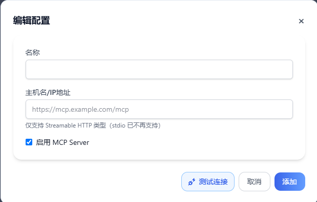

3. 单击**添加**。

##### 修改 MCP Server 配置

如需修改 MCP Server 配置，遵循以下步骤。

1. 在左侧导航栏单击**技能·工具**，选择**工具（MCP Server）**页签。
2. 单击指定 MCP Server 对应的编辑图标。
3. 在弹出的对话框中修改 MCP Server 的配置信息。有关 MCP Server 的配置信息，参见[添加 MCP Server](#添加-mcp-server)。
4. 单击**保存**。

##### 删除 MCP Server 配置

如需删除 MCP Server 配置，遵循以下步骤。

1. 在左侧导航栏单击**技能·工具**，选择**工具（MCP Server）**页签。
2. 单击指定 MCP Server 对应的删除图标。
3. 在弹出的对话框中，单击**确定**。

#### 导入导出

KIP 支持提示词、MCP Server 配置信息的批量处理，导入导出功能按钮分布在提示词、MCP Server 配置页面。

##### 导入配置

- 支持去重导入 JSON 格式的提示词或 MCP Server 配置信息。
- 支持预览待导入的配置信息，方便用户核对待导入的内容和格式。
- 支持设置筛选条件，仅导入符合要求的提示词。
- 执行导入操作时，即使部分数据导入失败，系统也不回滚导入成功的数据，只一次性返回导入失败的全部数据，方便用户集中查看与处理。

::: warning
- 导入 MCP Server 配置时，系统仅校验配置格式与字段完整性，不验证配置项的业务逻辑准确性。
- 如果待导入的 MCP Server 配置文件为空或者格式错误，则导入失败并返回报错。
:::

如需导入 MCP Server 或 提示词 配置信息，遵循以下步骤。

1. 在左侧导航栏单击**技能·工具**，选择**工具（MCP Server）**或**提示词**页签。
2. 单击**导入**。
3. 在弹出的对话框中选择待导入的目标文件，单击**打开**。
4. 在弹出的对话框中，预览待导入的配置信息，选择待导入的目标文件，单击**导入**。
   
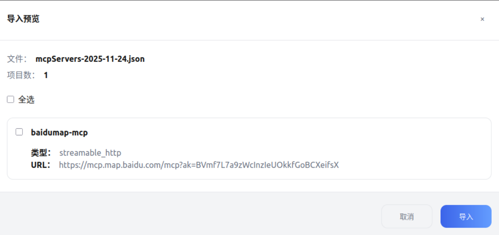

##### 导出配置

KIP 支持指定导出配置，仅将需要导出的配置信息进行导出。

如需导出配置信息，遵循以下步骤。

1. 在左侧导航栏单击**技能·工具**，选择**工具（MCP Server）**或**提示词**页签。
2. 选择待导出的配置项，单击**导出**。

## 洞察

### 仪表板

KIP 支持仪表板的全生命周期管理，主要功能如下：

- 添加图表：对话创建、外部图表、会话添加，智能推荐。
- 智能推荐：根据选择的数据源自动分析数据特征进行智能推荐，可采用，可弃用，采用的在图表库中统一管理。
- 解读报告：将仪表板展示所有指标数据整理成 word 报告，支持下载和定期推送。
- AI 智能洞察：
- 数据刷新：
    - 自动刷新：自定义设置数据刷新频率，支持`5s`、`10s`、`30s`、`1m`、`5m`、`15m`、`30m`、`1h`、`关闭`选项。
    - 手动刷新：提供整体仪表板刷新和单个图表刷新按钮。
- 图表功能：
    - 高级分析：支持趋势预测、智能填补、异常检测
    - SQL 查看：查看图表底层 SQL 语句
    - 表格切换：图表数据以表格形式展示
    - 放大：放大展示图表
    - 导出：支持 PNG、JPEG
    - AI 调整：根据现有展示图表，修改展示指标、时间范围等重新生成新的图表覆盖原展示图表
    - 解读图表：分析指标含义、数据范围，数据趋势走向、识别异常点，总结整体数据情况，并给出适当的建议措施。
    - 编辑标题：修改标题，更加具有业务场景化和背景化
    - 删除图表：将图表从当前仪表板删除
- 整理布局：仪表板中的所有图表均支持通过拖拽方式调整位置、大小；当整个仪表板布局混乱时，可点击**整理布局**，会对当前仪表板做一次整体的布局调整，稍后再手动简单调整下即可。

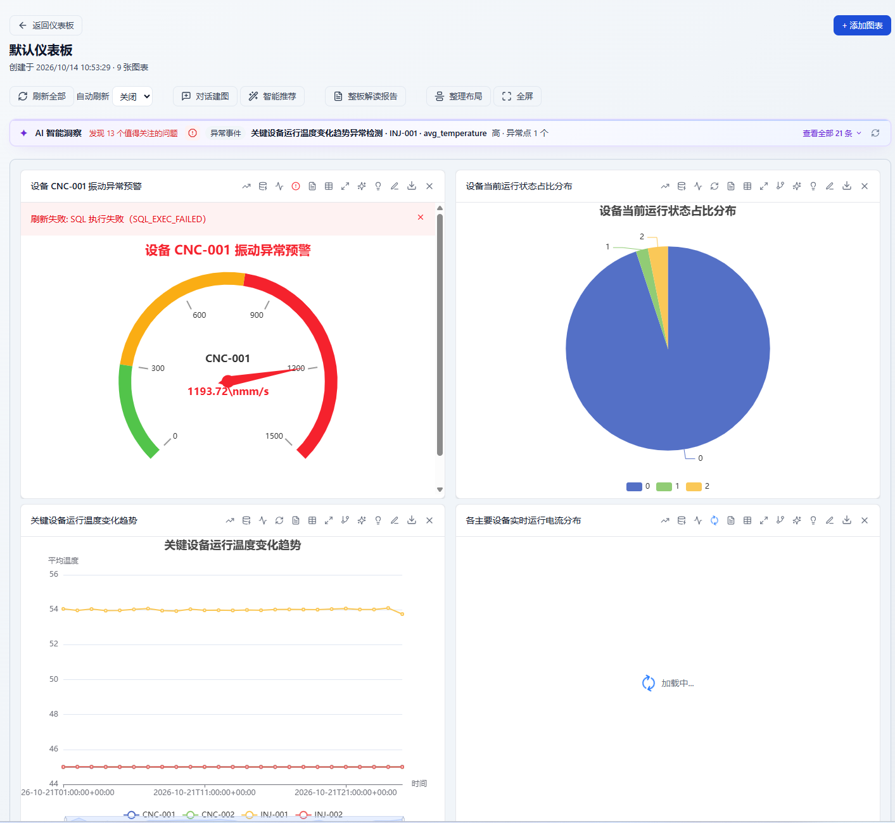

#### 基本操作

##### 新建仪表板

1. 在左侧导航栏单击**洞察**下的**仪表板**。
2. 点击右上角的*新建仪表板*按钮。
3. 输入仪表板名称，点击*保存*。

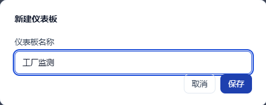

##### 查看仪表板

已创建的仪表板自动保存在**仪表板**区域，单击任意仪表板下面的*打开*按钮即可查看该仪表板中全部的图表信息。

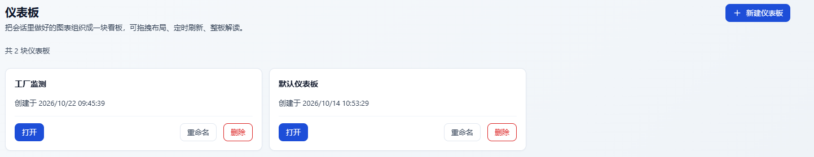

##### 重命名

根据仪表板中展示的指标信息，对现有仪表板进行重命名，让仪表板更有识别度。点击目标仪表板右下角的*重命名*按钮即可修改。

##### 删除

支持对不需要的仪表板执行删除操作。删除时做二次确认，防止误删；仪表板删除后，仅解除图表与仪表板的关联关系，其中的图表可在**图表库**中查看和再次添加至其他仪表板。

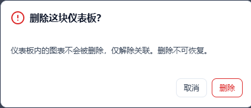

#### 仪表板整体功能特性

##### 切换仪表板

在每个仪表板中左上角，存在一个下拉框，展示当前已存在的仪表板列表，在这可以进行仪表板的切换，也可点击*返回仪表板*，在仪表板主页面进行切换。

##### 添加图表

KIP 支持从多种渠道添加图表：
- 现有*对话*中已完成的数据分析。
- *仪表板*对话式生成。
- *智能推荐*生成
- 外部添加，比如Grafana。

第一种：仪表板新建。

点击*对话建图*，在弹出的对话框中填入图表生成信息。

- 图表创建信息：用自然语言的方式输入需求描述，比如，```text查询工厂监测表最近一小时的PM2.5的浓度趋势变化```
- 添加至会话：可选，将本次对话保存至对话列表；若不勾选，本次会话内容将无法找回。
- 数据源配置：可从当前已配置过的数据源中选择。
- 目标仪表板：生成的图表期望在哪个仪表板展示，从当前已存在的仪表板列表选择当前。
- 点击*生成*，会进入图表生成阶段。

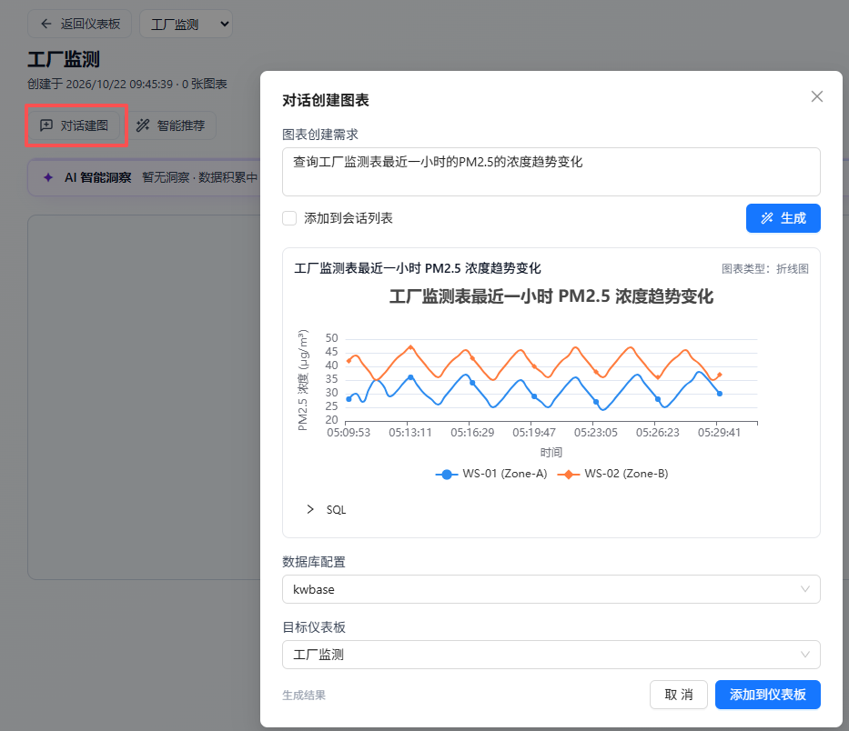

第二种：现有**对话**中添加。

点击**仪表板**右上角*添加图表*

在弹出的对话框中选择*从会话添加*

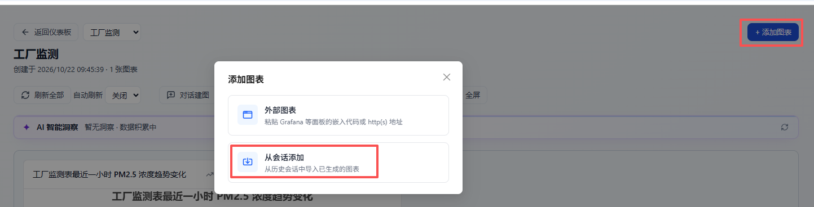

弹出当前**对话列表**中已存在的历史会话，选择目标会话  

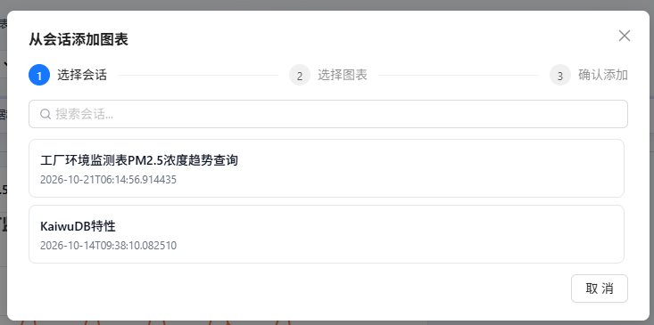

会列出会话中全部图表，首次默认全部勾选，选择需要添加至仪表板的图表后，点击下一步

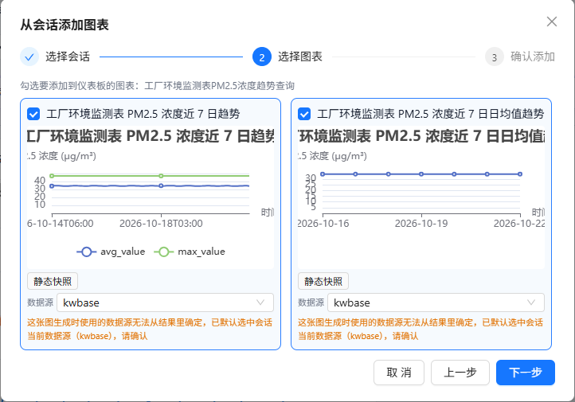

选择目标仪表板，点击*确认添加 x 个图表*

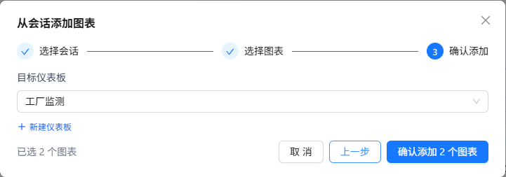

:::
当重复从同一个对话添加图表至仪表板时，已添加至仪表板的图表默认不勾选
:::

第三种：外部添加。

点击**仪表板**右上角*添加图表*

在弹出的对话框中选择*外部图表*

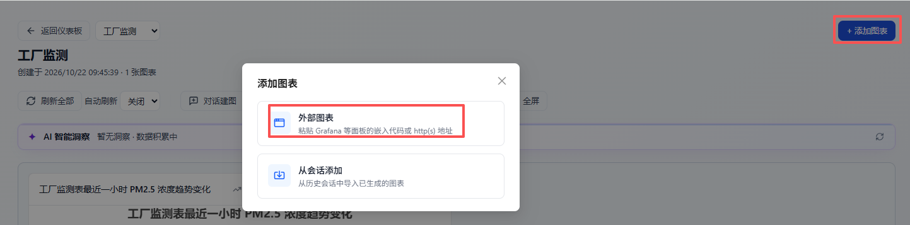

弹出外部图表配置页面，提供两种方式添加
-  Grafana iframe 内嵌代码
- 面板 https 地址

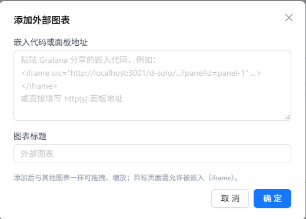

选择目标仪表板，最后，点击确定，就可在目标仪表板中查看添加的图表数据信息。

第四种：*智能推荐*

点击仪表板中的*智能推荐*，填写数据源相关信息：
- 数据库：数据源，默认全选
- 数据表：数据源下有权限的表列表，默认全选
- 推荐数量：默认6个，有效值为 1 ~ 20，当输入数值大于 20 时，会按着 20 个进行推荐
- 推荐指令：可选，500 字以内，比如可输入关注的指标值、时间范围等信息
- 添加至会话列表：勾选后，在【 AI 分析 - 对话】中可查看具体图表生成过程

以上信息确认完毕后，点击*开始推荐*

*注意：如果想将本次智能推荐的过程保存在对话列表，需要在点击*开始推荐*之前勾选*

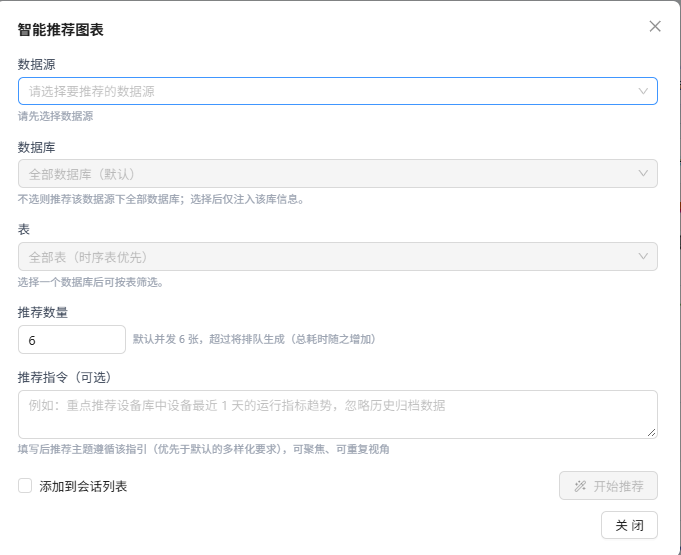

推荐过程需要持续一段时间，在推荐生成过程期间，可关闭推荐窗口，稍后在目标仪表板中再次点击*智能推荐*可查看当前推荐进度或历史推荐记录。

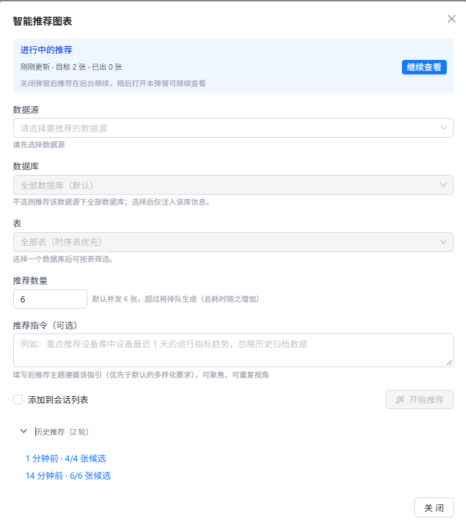

推荐的图表可采用，也可弃用，采用的图表也可在**图表库**中查看。如果当前推荐结果都想采用，可以逐一点击*采用*，也可点击*全部采用*。

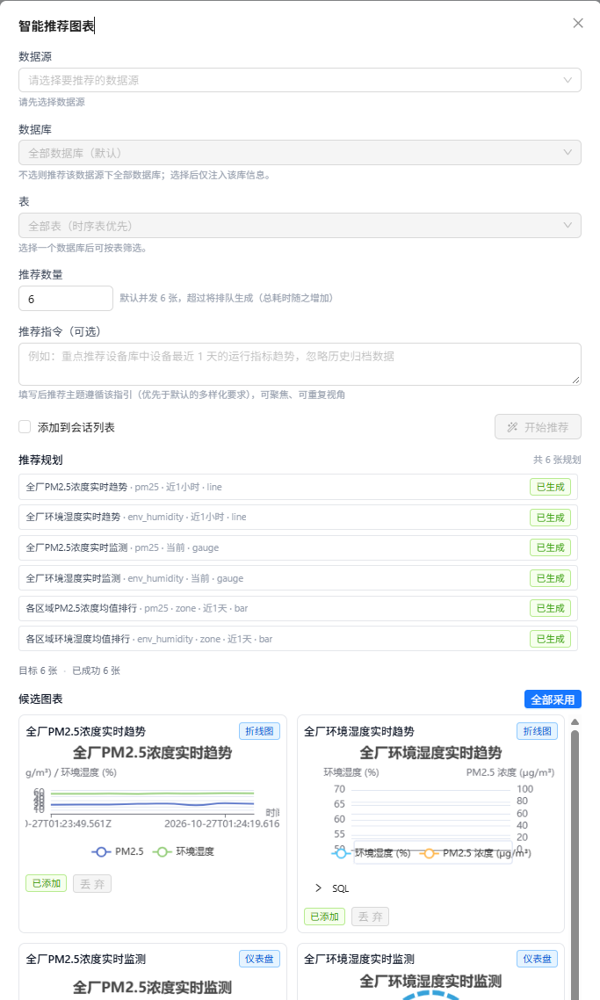

如果对当前的推荐结果都不满意，也可点击右下角的*重新推荐*，也可直接点击*关闭*。

##### 整板解读报告

对整个仪表板内展示的所有图表指标数据进行解读，并生成 word，如有需要，可配置定时任务，周期性推送至您个人指定地址。

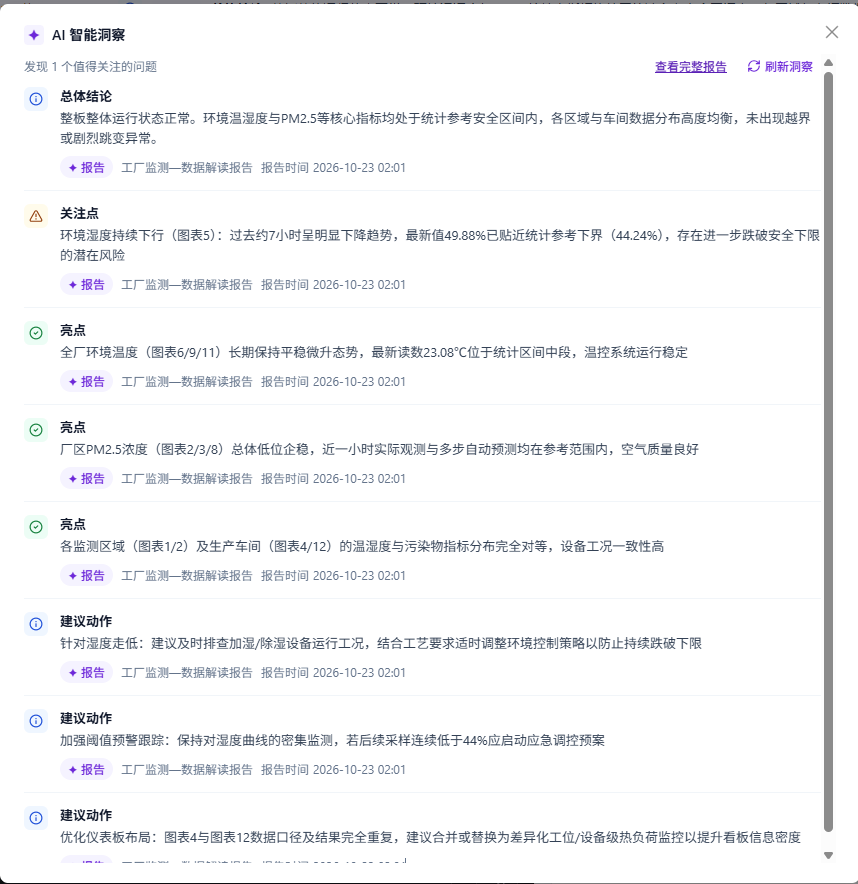

生成一次整板解读报告之后，会在仪表板上方生成*AI 智能洞察*，对当前仪表板值得关注的问题、异常点进行总结。可点击右侧的*查看全部 xxx 条*查看具体洞察结果。也可点击*刷新*按钮刷新洞察结果。

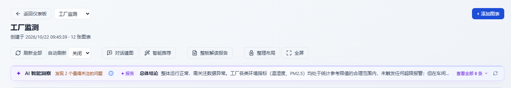


点击*查看完整报告*，可下载和配置定时推送。

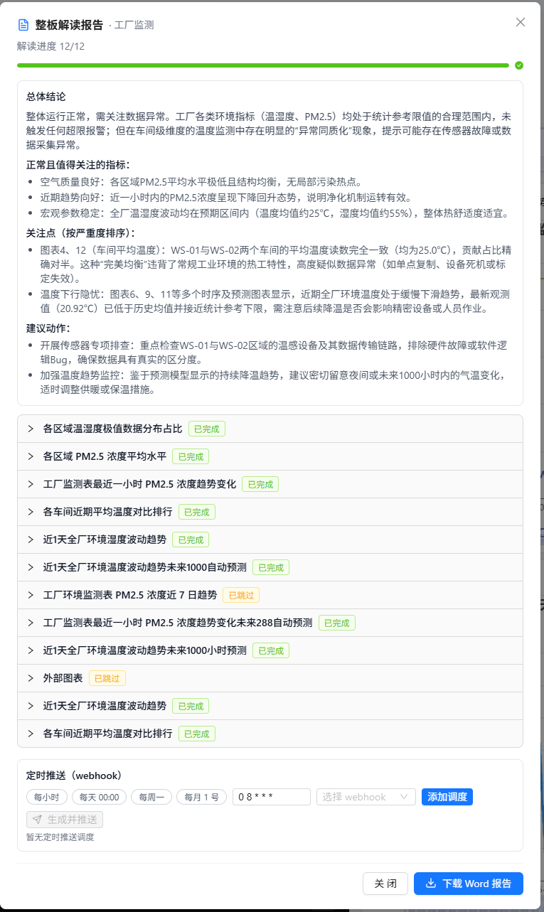

#### 单个图表功能特性

##### 基本功能

- SQL 查看：查看图表底层 SQL 语句，并且支持在线编辑修改 sql，修改后点击保存。

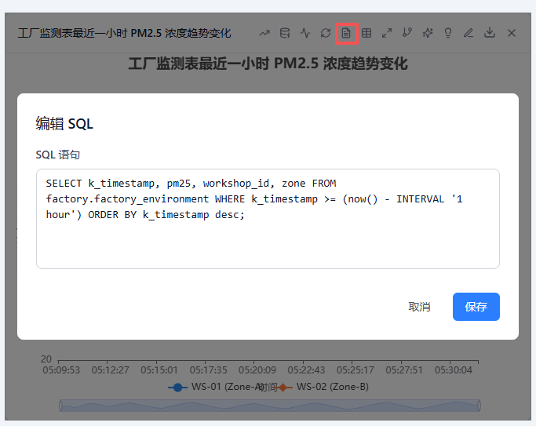

- 表格切换：图表数据以表格形式展示

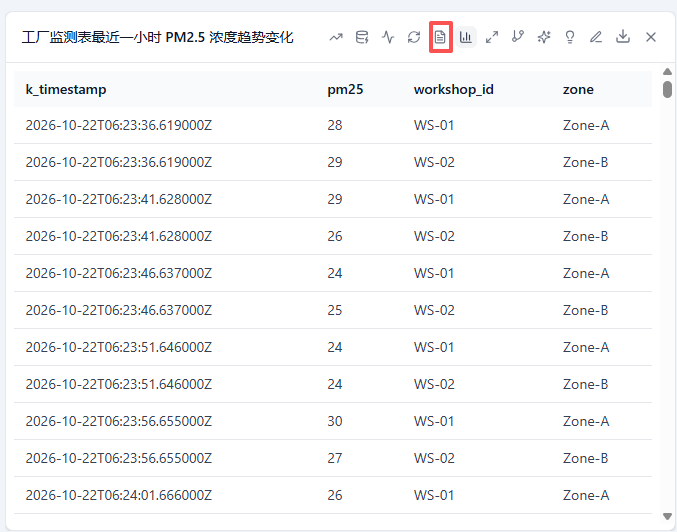

- 放大：放大展示图表

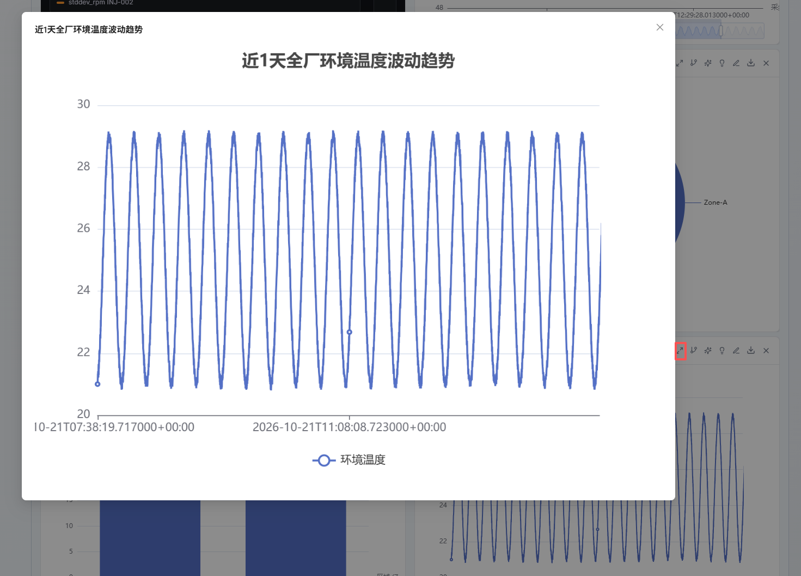

- 切换图表类型

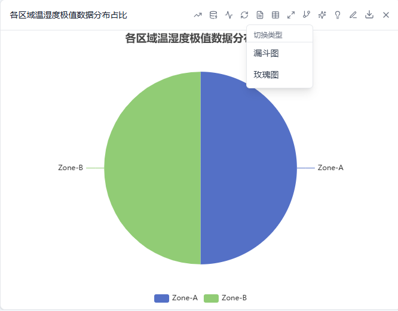

- 导出：支持 PNG、JPEG、CSV、EXCEL

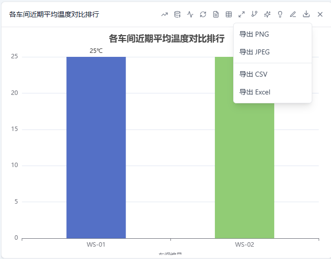

- 编辑图表：修改图表名称、图内标题、增加副标题、图内标题位置、图例位置，以及自定义系列颜色，让数据展示更加具有业务场景化和背景化

*注意：派生卡（预测/填补/异常）禁改颜色图例*

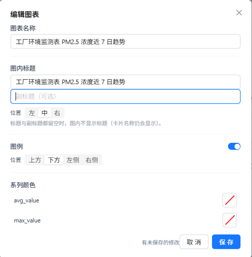

- 删除图表：将图表从当前仪表板删除

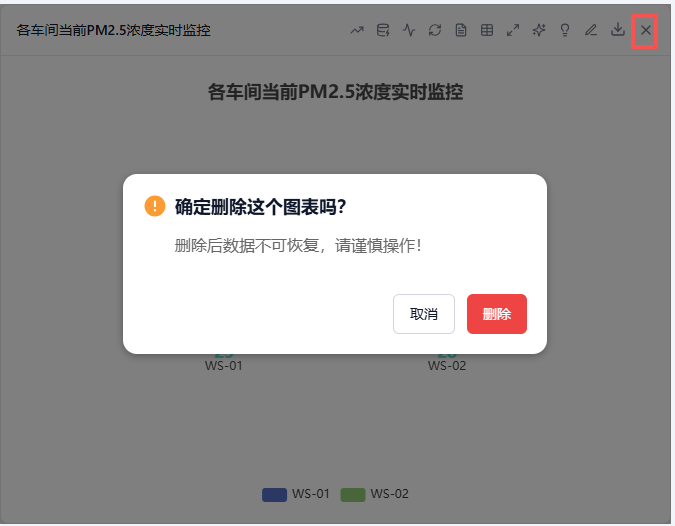

- AI 调整：用自然语言的方式，修改展示指标、时间范围、标题等

*注意：如果想将本次 AI 改图的过程保存在对话列表，需要在点击**生成**之前勾选*

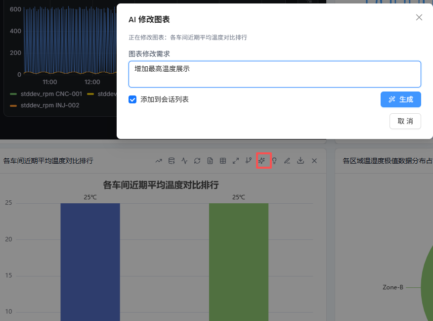

重新生成新的图表可选择*新增卡片*还是*替换原有卡片*

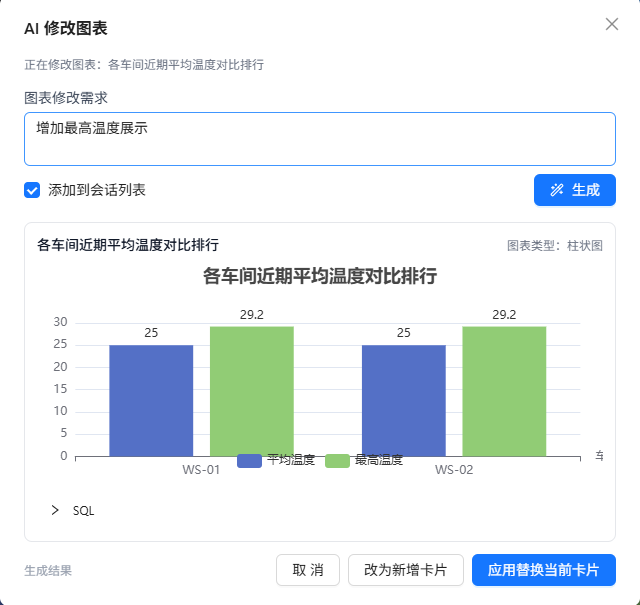

##### 高级分析

- 趋势预测：点击图表的*生成预测*按钮，弹窗可进行相关趋势参数修改
    - 时间列：当前图表数据源中的时间戳列
    - 数值列：当前图表展示的指标列
    - 分组列：当前图表的分组列
    - 预测步数：从最后一笔历史数据开始，向后连续预测 xxx 个点,**间隔由【时间单位 / 原始采样间隔】决定，*举例：原始是 10s 一个点 → 预测往后 1000×10s ≈ 2.78 小时；***，如果数值标红，代表超过上限 `1000`
    - 时间单位：`自动、分钟、小时、天、周、月`。默认`自动`，代表自动识别你数据的采样间隔
    - 置信水平：`95%、90%、80%`，默认 `95%`，置信越高，区间越宽
    - 季节周期：空代表自动根据数据间隔推断，如果周期比较明确，可手动配置，提高稳定性
- 异常检测
    - 检测方法：支持 `Z‑Score`、`IQR 四分位`、`MAD 中位数绝对偏差`、`季节分解`
    - 时间列：当前图表数据源中的时间戳列
    - 数值列：当前图表展示的指标列
    - 分组列：当前图表的分组列
    - 检测阈值：当监测值，偏离本组均值超过 ±3 倍标准差，判定为异常点。默认值为 `3`，调小（如 2.0）会更灵敏、告警变多；调大（如 4）更保守、告警变少
    - 季节周期：空代表自动根据数据间隔推断，如果周期比较明确，可手动配置，提高稳定性

    | 检测方法 | 核心原理 | 应用场景 |
    | ------- | -------- | ------- |
    | `Z‑Score`           | 基于均值 + 标准差，看数值偏离均值多少个 σ，默认阈值 3	| 数据近似正态、平稳、无强周期 |
    | `IQR 四分位`        | 四分位数间距，超过 Q1-1.5IQR / Q3+1.5IQR 判定异常	  |  数据分布不规则、偏态，不要求正态 |
    | `MAD 中位数绝对偏差` | 用中位数代替均值、MAD 代替标准差做离群判断	            | 脏数据多、存在大量极端值的场景 |  
    | `季节分解`          | 把时序拆成：趋势项 + 季节周期项 + 残差项，对残差做异常判断	| 有固定周期规律（比如：白天生产 PM2.5 高、夜间低，24h / 班次周期）|

- 数据填补
    - 填补方法：支持`线性插值`、`样条插值`、`前向填充`、`后向填充`、`季节均值`
    - 时间列：当前图表数据源中的时间戳列
    - 数值列：当前图表展示的指标列
    - 分组列：当前图表的分组列
    - 时间单位：`自动、分钟、小时、天、周、月`。默认`自动`，代表自动识别你数据的采样间隔
    - 季节周期：空代表自动根据数据间隔推断，如果周期比较明确，可手动配置，提高稳定性

    | 填补方法 | 核心原理 | 应用场景 |
    | ------- | -------- | ------- |
    | `线性插值` | 缺失段前后两个有效点之间，按时间做直线均匀补值。例：10:00=20，10:02=24，10:01 缺失 → 补 22 | 缓慢平滑变化指标：温度、湿度 |
    | `样条插值` | 平滑曲线插值（二次 / 三次样条），不是直线，让过渡更顺滑 | 指标变化连续、曲线有弧度，比如缓慢升降的温度 |
    | `前向插值` | 拿上一个已知有效值一直往后填。例：10:00=22，之后断连到 10:03 才恢复 25 → 10:01、10:02 都填 22 | 设备短暂断连、短丢包；稳态工况，指标变化很慢 |  
    | `后向插值` | 用后面最近的有效值往前回填	| 离线历史补数、已知后面稳定值 | 
    | `季节均值` | 取相同时刻历史周期的平均值填充（比如今天 14 点缺失，用过往几天 14 点的均值） | 有强周期性指标 |

- 根因分析：针对异常事件，调用业务知识、历史趋势，形成关于原因的假设并进行验证，生成结构化报告，给出建议性操作。
- 图表解读：分析指标含义、数据范围，数据趋势走向、识别异常点，总结整体数据情况，并给出适当的建议措施。

    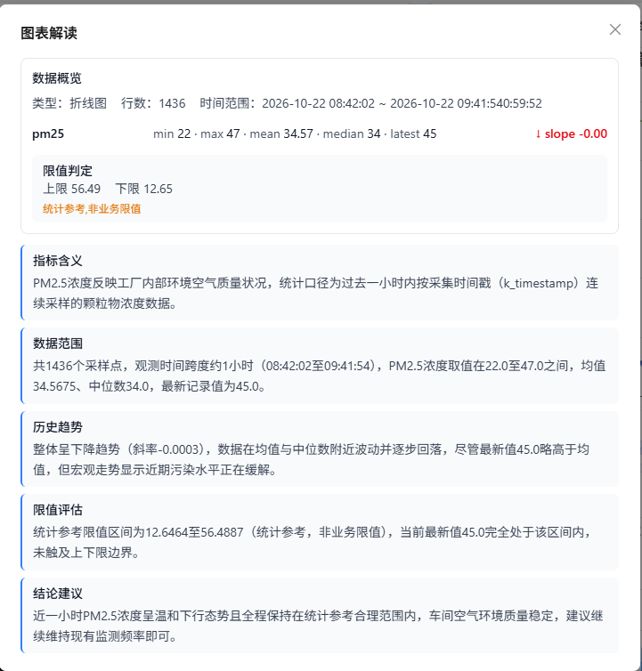

::: Notes 说明
预测、异常检测、数据填补，均以新的图表添加在当前仪表板最后；

某个图表进行异常检测后，异常检测记录可以在【自动化 → 执行记录 → 异常告警】页面中查看所有历史检测记录。
:::

### 图表库

**图表库**中的图表来源有以下几种：
- **对话**中生成；
- **仪表板**中创建；
- *智能推荐*：只保留采用的图表；
- 外部添加。

图表库中默认保留系统中以上途径生成的全部图表。可删除、展示和加入仪表板，加入仪表板支持添加至现有多个仪表板。也可根据数据源、图表标题、图表类型筛选。

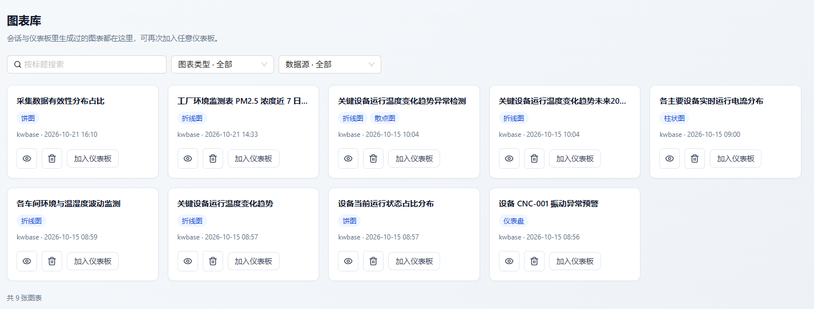

## 自动化

### 智能任务

如果需要通知到您的第三方软件/系统，请提前添加通知，具体步骤参考[设置—通知](#通知)

#### Agent任务

##### 新建 Agent 任务

如需新建 Agent 任务，可点击左侧导航栏中的**智能任务**下**Agent 任务**，点击右上角的*新建任务*，编辑调度配置
*需提前配置提示词【AI 分析-技能·工具-提示词】、数据库【数据空间-数据源】、模型【设置—模型】和通知【设置—通知，可选】*
- 基础信息
    - 任务名称：自定义，方便在任务列表识别
    - 任务描述：任务用途
    - 模型：已配置好的 LLM 模型，用于处理任务
    - 数据库：数据源
    - 提示词：选择提前建好的提示词模板，决定大模型怎么分析数据

- 调度配置
    - 执行计划：任务执行周期，可自定义，也可选择预设周期
    - 是否启用：可根据需要选择是否启用

- 通知设置：可以设置通知地址，也可不通知，默认不通知

配置完成后，点击*保存*按钮。

在任务列表页面，可点击*立即执行*测试任务是否可以正常执行。也可点击*执行记录*，跳转到**自动化*下**执行记录**下对应页面查看执行历史记录。


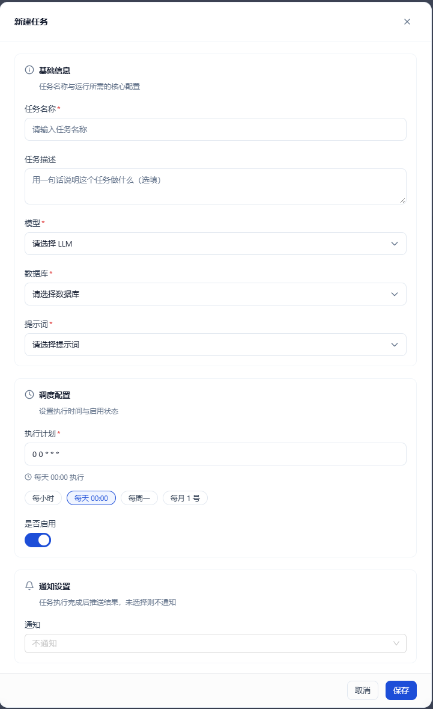

##### 编辑 Agent 任务

如需修改某个 Agent 任务的名称、描述、模型、调度周期等信息，可点击对应任务右下角的*编辑*按钮，在弹窗中进行修改任务配置，修改完后点击*保存*按钮。

##### 删除 Agent 任务

如果某个任务不需要保留，可可点击对应任务右下角的*删除*按钮，在弹窗中点击*确认删除*按钮。删除操作不可恢复，请谨慎操作。

#### 仪表板解读

##### 新建仪表板解读

如需新建仪表板解读，可点击左侧导航栏中的**智能任务**下**仪表板解读**，点击右上角的*新建解读*，编辑调度配置
- 仪表板：选择目标仪表板
- 执行计划：解读执行周期，可自定义，也可选择预设周期
- 通知：webhook 地址

配置完成后，点击*保存*按钮。

在任务列表页面，可点击*查看仪表板*，可跳转至对应仪表板中查看图表。

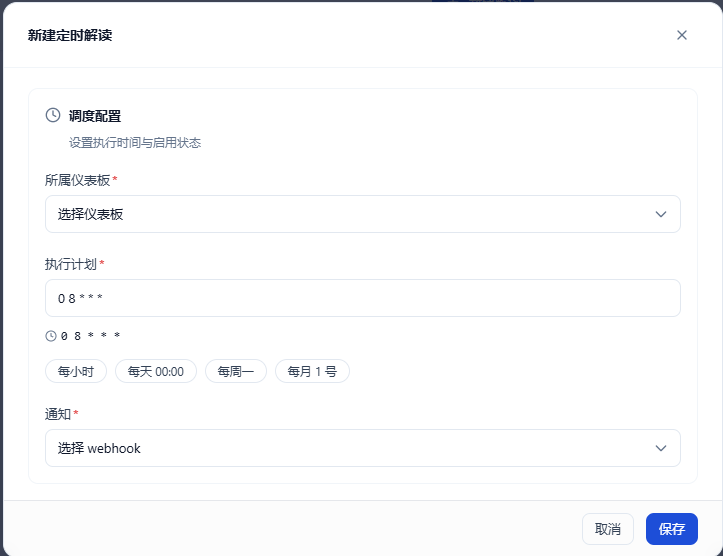

##### 编辑仪表板解读

如需修改某个仪表板解读任务的名执行计划、通知渠道等信息，可点击对应任务右下角的*编辑*按钮，在弹窗中进行修改任务配置，修改完后点击*保存*按钮。

##### 删除仪表板解读

如果某个任务不需要保留，可点击对应任务右下角的*删除*按钮，在弹窗中点击*确认删除*按钮。删除操作不可恢复，请谨慎操作。任务删除不影响仪表板解读，可随时根据需要添加任务。

#### 异常告警

##### 新建异常告警

如需监测指标值的异常值，可点击左侧导航栏中的**智能任务**下**异常告警**，点击右上角的*新建规则*，编辑异常告警规则
- 选择要监测的图表：图表列表展示的是**图表库**下有效图表
- 选择检测方法、阈值、季节周期、冷却时间
- 配置通知通道

配置完成后，点击*保存*按钮。

在任务列表页面，可点击*查看仪表板*，可跳转至对应仪表板中查看图表。

::: Notes 说明
- 当前异常告警的检测频率默认是 5 分钟
- 有效图表：指的是非外部图表，且图表底层SQL逻辑、数据源都有的图表
:::


##### 编辑异常告警

如需修改某个异常告警任务的名检测方法、阈值、季节周期、冷却时间、通知渠道等信息，可点击对应任务右下角的*编辑*按钮，在弹窗中进行修改任务配置，修改完后点击*保存*按钮。

##### 删除异常告警

如果某个任务不需要保留，可点击对应任务右下角的*删除*按钮，在弹窗中点击*确认删除*按钮。删除操作不可恢复，请谨慎操作。任务删除不影响该图表的异常检测与历史事件，可随时重新添加规则。

### 执行记录

记录智能任务中正在启用状态中的所有历史执行记录，包含 Agent 任务、仪表板解读、异常告警，以及在仪表板中进行过异常检测的图表的检测记录。

#### Agent 任务

可按任务名称、状态、时间范围筛选查看。如果对某个任务执行记录存在疑问，可添加至对话进行下一步的问题定位。


#### 仪表板解读

可按报告标题、状态、时间范围筛选查看。解读报告支持在线查看、下载。也可跳转至仪表板查看具体数据。


#### 异常告警

可按图表标题、严重度、是否推送、时间范围筛选查看。支持跳转至仪表板查看具体数据。


#### 多选删除

点击任务执行记录右上角的*多选*，支持*全选*或者逐一勾选进行删除。