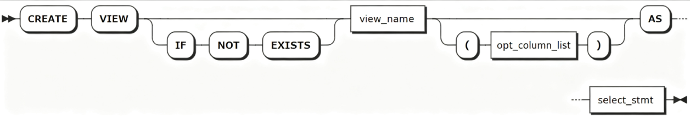
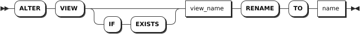
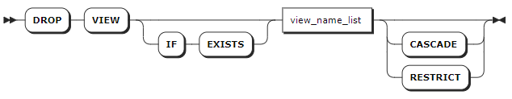

# 视图

## 创建视图

`CREATE VIEW` 语句用于创建新视图，即系统存储的以虚拟表形式表示的查询结果。

### 所需权限

- 非三权分立模式下，用户是 `admin` 角色的成员或者拥有所属数据库的 CREATE 权限和引用表的 SELECT 权限。默认情况下，`root` 用户属于 `admin` 角色。
- 三权分立模式下，用户是 `sysadmin` 角色的成员或者是拥有所属数据库 CREATE 权限和引用表 SELECT 权限的普通用户。默认情况下，`sysroot` 用户属于 `sysadmin` 角色。

### 语法格式



### 参数说明

| 参数 | 说明 |
| --- | --- |
| `IF NOT EXISTS` | 可选关键字，当使用 `IF NOT EXISTS` 关键字时，如果目标视图不存在，系统创建视图。如果目标视图存在，系统创建视图失败，但不会报错。当未使用 `IF NOT EXISTS` 关键字时，如果目标视图不存在，系统创建视图。如果目标视图存在，系统报错，提示目标视图已存在。 |
| `view_name` | 待创建视图的名称，该名称在数据库中必须唯一，并且遵循[数据库标识符规则](../../../sql-reference/sql-identifiers.md)。如果没有将父数据库设置为默认值，必须将视图名称格式设置为 `database.view_name`。 |
| `opt_column_list` | 可选项，视图列名列表。支持指定一个或多个视图的列名，列名之间使用逗号（`,`）隔开。如果指定视图的列名，控制台输出指定的列名，而不是输出通过 `select_stmt` 语句指定的列的列名。 |
| `select_stmt` | `SELECT` 查询语句。支持使用 `*` 选择源表中的所有列。<br >- 当 `select_stmt` 的结果集中存在同名列时，系统报错，提示 `duplicate column name: "a"`。<br >- 当源表新增列后，视图结构不会发生变化。<br >- 当删除视图依赖的源表中的列时，系统报错，提示 `cannot drop column "b" because view "v" depends on it`。 |

### 语法示例

以下示例为创建一个名为 `sensor_data` 的表，包括时间戳列，温度、湿度和设备ID，并为 `sensor_data` 表创建一个名为 `v_sensor_min_agg` 视图，统计每分钟设备平均温湿度。

```sql
-- 1. 创建sensor_data。

create table sensor_data ( 
-- 时序时间戳（核心主键）
 ts timestamp not null,
-- 指标：温度
 temperature double ,
-- 指标：湿度
 humidity double
)tags(device_ID varchar(50) not null
) primary tags(device_ID);

-- 2. 批量写入传感器时序数据

INSERT INTO sensor_data (ts, temperature, humidity, device_id)
VALUES
('2026-07-14 08:00:01', 25.3, 48.2, 'dev_001'),
('2026-07-14 08:00:02', 25.5, 48.1, 'dev_001'),
('2026-07-14 08:00:03', 25.4, 48.0, 'dev_001'),
('2026-07-14 08:01:01', 25.3, 48.2, 'dev_001'),
('2026-07-14 08:01:02', 25.6, 48.0, 'dev_001'),
('2026-07-14 08:01:03', 25.2, 48.3, 'dev_001'),
('2026-07-14 08:00:01', 26.3, 47.9, 'dev_002'),
('2026-07-14 08:00:02', 26.1, 47.8, 'dev_002'),
('2026-07-14 08:00:03', 26.2, 47.9, 'dev_002'),
('2026-07-14 08:01:01', 26.3, 47.7, 'dev_002'),
('2026-07-14 08:01:02', 26.4, 47.6, 'dev_002'),
('2026-07-14 08:01:03', 26.5, 47.8, 'dev_002');

-- 3. 创建视图v_sensor_min_agg。

create view v_sensor_min_agg as
select
	date_trunc('minute', ts) as collect_time,
	device_id,
	avg(temperature) as avg_temp,
	avg(humidity) as avg_humi
from
	sensor_data
group by
	collect_time,
	device_id;

-- 4. 查看有哪些视图。

show tables;
     table_name    |    table_type
-------------------+--------------------
  sensor_data      | TIME SERIES TABLE
  v_sensor_min_agg | VIEW
(2 rows)

-- 5. 查看视图的创建语句。

 show create view v_sensor_min_agg;
     table_name    |                                                                                                                        create_statement
-------------------+------------------------------------------------------------------------------------------------------------------------------------------------------------------------------------------------------------------------------------------------------------------
  v_sensor_min_agg | CREATE VIEW v_sensor_min_agg (collect_time, device_id, avg_temp, avg_humi) AS SELECT date_trunc('minute', ts) AS collect_time, device_id, avg(temperature) AS avg_temp, avg(humidity) AS avg_humi FROM tsdb.public.sensor_data GROUP BY collect_time, device_id
(1 row)

-- 6. 查看视图信息。

SELECT * FROM v_sensor_min_agg;
        collect_time        |      avg_temp      |      avg_humi      | device_id
----------------------------+--------------------+--------------------+------------
  2026-07-14 08:00:00+00:00 | 26.200000000000003 |  47.86666666666667 | dev_002
  2026-07-14 08:01:00+00:00 | 26.400000000000002 |  47.70000000000001 | dev_002
  2026-07-14 08:00:00+00:00 | 25.399999999999995 |               48.1 | dev_001
  2026-07-14 08:01:00+00:00 |  25.36666666666667 | 48.166666666666664 | dev_001
(4 rows)
```

## 修改视图

`ALTER VIEW` 语句用于修改视图的名称。

### 所需权限

- 非三权分立模式下，用户是 `admin` 角色的成员或者拥有重命名前视图的 DROP 权限以及重命名后视图所属父数据库的 CREATE 权限。默认情况下，`root` 用户属于 `admin` 角色。
- 三权分立模式下，用户是 `sysadmin` 角色的成员或者是拥有重命名前视图的 DROP 权限以及重命名后视图所属父数据库 CREATE 权限的普通用户。默认情况下，`sysroot` 用户属于 `sysadmin` 角色。

### 语法格式



### 参数说明

| 参数 | 说明 |
| --- | --- |
| `IF EXISTS` | 可选关键字。当使用 `IF EXISTS` 关键字时，如果目标视图存在，系统修改目标视图。如果目标视图不存在，系统修改目标视图失败，但不会报错。当未使用 `IF EXISTS` 关键字时，如果目标视图存在，系统修改目标视图。如果目标视图不存在，系统报错，提示目标视图不存在。 |
| `view_name` | 待重命名的视图的名称。支持使用 `SELECT * FROM information_schema.tables WHERE table_type = 'VIEW'` 语句查看视图名称。 |
| `name` | 新的视图名称。该名称在数据库中必须唯一，并且[遵循数据库标识符规则](../../sql-identifiers.md)。 |

### 语法示例

以下示例将 `test_view` 视图重命名为 `names`。

```sql
-- 1. 查看所有视图。

SELECT * FROM information_schema.tables WHERE table_type = 'VIEW';
  table_catalog | table_schema |    table_name    | table_type | is_insertable_into | version | namespace_oid
----------------+--------------+------------------+------------+--------------------+---------+----------------
  tsdb          | public       | v_sensor_min_agg | VIEW       | NO                 |       1 |    3015832540
(1 row)

-- 2. 将 v_sensor_min_agg 视图重命名为 v_sensor_avg_agg。

ALTER VIEW v_sensor_min_agg rename to v_sensor_avg_agg;
RENAME VIEW

-- 3. 查看所有视图。

SELECT * FROM information_schema.tables WHERE table_type = 'VIEW';
  table_catalog | table_schema |    table_name    | table_type | is_insertable_into | version | namespace_oid
----------------+--------------+------------------+------------+--------------------+---------+----------------
  tsdb          | public       | v_sensor_avg_agg | VIEW       | NO                 |       3 |    3015832540
(1 row)
```

## 删除视图

`DROP VIEW` 语句用于从数据库中删除视图。

### 所需权限

- 非三权分立模式下，
  - 删除无依赖关系的视图：用户是 `admin` 角色的成员或者拥有目标视图的 DROP 权限。默认情况下，`root` 用户属于 `admin` 角色。
  - 删除存在依赖关系的视图：用户是 `admin` 角色的成员或者拥有目标视图的 DROP 权限及其关联对象的 DROP 权限。默认情况下，`root` 用户属于 `admin` 角色。
- 三权分立模式下：
  - 删除无依赖关系的视图：用户是 `sysadmin` 角色的成员或者是拥有目标视图 DROP 权限的普通用户。
  - 删除存在依赖关系的视图：用户是 `sysadmin` 角色的成员或者是拥有目标视图及其关联对象 DROP 权限的普通用户。

### 语法格式



### 参数说明

| 参数 | 说明 |
| --- | --- |
| `IF EXISTS` | 可选关键字。当使用 `IF EXISTS` 关键字时，如果目标视图存在，系统删除目标视图。如果目标视图不存在，系统删除目标视图失败，但不会报错。当未使用 `IF EXISTS` 关键字时，如果目标视图存在，系统删除目标视图。如果目标视图不存在，系统报错，提示目标视图不存在。 |
| `view_name_list` | 待删除的视图名称列表。支持指定一个或多个无依赖关系的视图，视图名称之间使用逗号（`,`）隔开。支持使用 `SELECT * FROM information_schema.tables WHERE table_type = 'VIEW'` 语句查看视图名称。  |
| `CASCADE` | 可选关键字。删除目标视图及其关联对象。`CASCADE` 不会列出待删除的关联对象，应谨慎使用。 |
| `RESTRICT` | 默认设置，可选关键字。如果其他对象依赖目标视图，则无法删除该视图。 |

### 语法示例

以下示例删除 `names` 视图。

```sql
-- 1. 查看所有视图。

SELECT * FROM information_schema.tables WHERE table_type = 'VIEW';
  table_catalog | table_schema |    table_name    | table_type | is_insertable_into | version | namespace_oid
----------------+--------------+------------------+------------+--------------------+---------+----------------
  tsdb          | public       | v_sensor_avg_agg | VIEW       | NO                 |       3 |    3015832540
(1 row)

-- 2. 删除 names 视图。

DROP VIEW v_sensor_avg_agg;
DROP VIEW

-- 3. 查看所有视图。

SELECT * FROM information_schema.tables WHERE table_type = 'VIEW';
  table_catalog | table_schema | table_name | table_type | is_insertable_into | version | namespace_oid
----------------+--------------+------------+------------+--------------------+---------+----------------
(0 rows)
```
