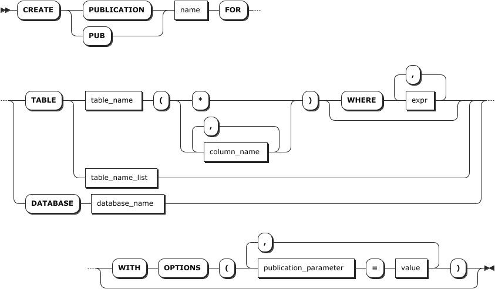
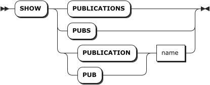
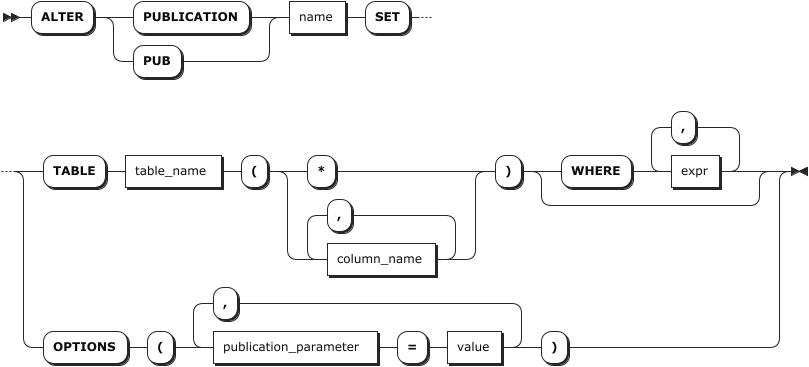
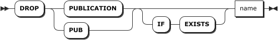

# 数据发布

## 创建发布

`CREATE PUBLICATION` 语句用于向当前数据库添加一个新的发布。发布的名称必须与当前数据库中任何现有发布的名称不同。

### 所需权限

- 用户拥有目标时序表的 `SELECT` 权限。

### 语法格式



### 参数说明

| 参数 | 说明 |
| --- | --- |
| `name` | 待创建发布的名称。该名称在当前数据库中必须唯一。 |
| `table_name` | 指定要添加到发布的表。<br >**说明** <br >目前，KWDB 只支持发布时序表，不支持发布关系表、临时表、内部视图和常规视图。 |
| `column_name` | 待发布的时序表的列。支持发布目标时序表的全部列或部分列。<br >- *：按照目标时序表结构发布全部列。<br >- 指定部分列：仅发布指定列。指定列时必须包含所有的主键列和非空列。 |
| `WHERE expr` | `WHERE` 子句，定义行筛选表达式。表达式计算结果为 `FALSE` 或 `NULL` 的行不会被发布。 |
| `table_name_list` | 指定要添加到发布的时序表列表。支持指定多个时序表，各表名之间使用逗号（`,`）隔开。<br >**说明** <br >不支持行筛选，也不支持指定列。 |
| `database_name` | 指定要添加到发布的时序库。指定后，系统将发布时序库中的所有表。<br >**说明** <br >- 不支持行筛选，也不支持指定列。<br >- 目前，KWDB 只支持发布时序库，不支持发布关系库。 |
| `publication_parameter` | 数据发布参数。支持以下参数：<br >- `buffer_size`：缓冲大小，单位 MiB。`0` 表示立即发送。默认情况下，设置为 `1`。<br >- `retrieve_tags`：是否补充或验证普通 Tag。支持 `on` 和 `off` 两个取值。`on` 表示开启补充或验证普通 Tag。当用户在发布任务输出列或者过滤列中指定普通 Tag 但写入数据时省略普通 Tag 的取值或者普通 Tag 与 Primary Tag 的对应关系与第一次写入数据时不一致，系统读取第一次写入的普通 Tag 的取值并更新当前普通 Tag 的取值，然后再进行发布。`off` 表示不开启补充普通 Tag 功能。当未开启补充普通 Tag 功能时，用户在发布任务输出列或者过滤列中指定了普通 Tag 但写入数据时未指定普通 Tag 的取值，系统按照 NULL 值处理省略的普通 Tag。如果用户写入的 Primary Tag 和普通 Tag 与第一次写入时的取值不匹配，系统会按照当前写入的普通 Tag 值进行发布。默认情况下，设置为 `off`。<br >- `publish`：数据发布的操作类型，支持 `insert`、`update`、`delete` 和 `all` 操作。默认情况下，设置为 `insert`。|
| `value` | 数据发布参数的取值。 |

### 语法示例

以下示例假设已经创建时序数据库（`benchmark`）和时序表（`cpu`、`sensor_data`） 并向表中写入相关数据。

```sql
-- 创建时序数据库。
CREATE TS DATABASE benchmark;

-- 创建时序表 benchmark.cpu。
CREATE TABLE benchmark.cpu (k_timestamp TIMESTAMPTZ NOT NULL, usage_user INT8 NOT NULL, usage_system INT8 NOT NULL, usage_idle INT8 NOT NULL) TAGS (id INT8 NOT NULL, hostname VARCHAR NOT NULL, region VARCHAR NOT NULL, datacenter VARCHAR NOT NULL) PRIMARY TAGS (id);

-- 向时序表 benchmark.cpu 中写入数据。
INSERT INTO benchmark.cpu (k_timestamp, usage_user, usage_system, usage_idle, id, hostname, region, datacenter) VALUES ('2024-01-22 22:22:22.224',2,3,4,647470401348904606,'locahost','nanjing','center');

-- 创建时序表 benchmark.sensor_data。
CREATE TABLE benchmark.sensor_data (k_timestamp TIMESTAMP NOT NULL, temperature FLOAT NOT NULL, humidity FLOAT, pressure FLOAT) TAGS (sensor_id INT NOT NULL,sensor_type VARCHAR(30) NOT NULL) PRIMARY TAGS (sensor_id);

-- 向时序表 benchmark.sensor_data 中写入数据。
INSERT INTO benchmark.sensor_data (k_timestamp, temperature, humidity, sensor_id, sensor_type) VALUES ('2023-10-01 08:00:00', 25.5, 60.0, 101, 'a'), ('2023-10-01 09:00:00', 26.0, 58.5, 101, 'b')；
```

- 创建一个发布，发布 `cpu` 表写入的实时数据，并只复制 `usage_user` 和 `usage_system` 两列。

    ```sql
    CREATE PUBLICATION cpu_filtered FOR TABLE benchmark.cpu (usage_user, usage_system);
    ```

- 创建一个发布，只发布 `cpu` 表的 `INSERT` 操作写入的数据。

    ```sql
    CREATE PUBLICATION insert_only FOR TABLE benchmark.cpu WITH OPTIONS (publish = 'insert');
    ```

- 创建一个发布，发布 `cpu` 和 `sensor_data` 两个表写入的实时数据，并补充普通 Tag 的取值。

    ```sql
    CREATE PUBLICATION mypub FOR TABLE benchmark.cpu, benchmark.sensor_data WITH OPTIONS (retrieve_tags = 'on');
    ```

- 创建一个发布，发布 `benchmark` 时序库中所有表的数据。

    ```sql
    CREATE PUBLICATION alltables FOR DATABASE benchmark;
    ```

## 查看发布

`SHOW PUBLICATIONS` 或 `SHOW PUBLICATION` 语句用于查看所有或指定数据发布的信息，包括数据发布的名称、对象、参数、创建时间、创建者、订阅者等重要信息。

### 所需权限

无

### 语法格式



### 参数说明

| 参数 | 说明 |
| --- | --- |
| `name` | 待查看发布的名称。|

### 返回字段说明

| 字段 | 说明 |
| --- | --- |
| `name` | 数据发布的名称。 |
| `pub_objects` | 数据发布的对象。 |
| `parameter` | 数据发布的指定参数。 |
| `create_at` | 数据发布的创建时间。 |
| `create_by` | 数据发布的创建者。 |
| `subscription` | 数据发布的订阅信息，只显示启动并连接的订阅。 |

### 语法示例

以下示例查看 `pub1` 数据发布的详细信息。

```sql
SHOW PUBLICATION mypub;
```

执行成功后，控制台输出以下信息：

```sql
  name  |                    pub_objects                    |                                                                                                                                                                                                                                                                                                                                                                                                                                                                    parameter                                                                                                                                                                                                                                                                                                                                                                                                                                                                    |            create_at             | create_by | subscription
--------+---------------------------------------------------+-------------------------------------------------------------------------------------------------------------------------------------------------------------------------------------------------------------------------------------------------------------------------------------------------------------------------------------------------------------------------------------------------------------------------------------------------------------------------------------------------------------------------------------------------------------------------------------------------------------------------------------------------------------------------------------------------------------------------------------------------------------------------------------------------------------------------------------------------------------------------------------------------------------------------------------------------+----------------------------------+-----------+---------------
  mypub | benchmark.public.cpu,benchmark.public.sensor_data | {"options": {"buffer_size": 1, "publish": "insert", "retrieve_tags": "on", "sub_timeout": 2}, "table_list": [{"column_ids": [1, 2, 3, 4, 5, 6, 7, 8], "column_names": ["k_timestamp", "usage_user", "usage_system", "usage_idle", "id", "hostname", "region", "datacenter"], "column_types": ["TIMESTAMPTZ(3)", "INT8", "INT8", "INT8", "INT8", "VARCHAR(254)", "VARCHAR(254)", "VARCHAR(254)"], "database": "benchmark", "id": 96, "is_star": true, "need_normal_tag": true, "schema": "public", "table": "cpu", "ts_column_name": "k_timestamp"}, {"column_ids": [1, 2, 3, 4, 5, 6], "column_names": ["k_timestamp", "temperature", "humidity", "pressure", "sensor_id", "sensor_type"], "column_types": ["TIMESTAMPTZ(3)", "FLOAT8", "FLOAT8", "FLOAT8", "INT4", "VARCHAR(30)"], "database": "benchmark", "id": 97, "is_star": true, "need_normal_tag": true, "schema": "public", "table": "sensor_data", "ts_column_name": "k_timestamp"}]} | 2025-10-11 06:49:46.238842+00:00 | root      | null
(1 row)
```

## 修改发布

`ALTER PUBLICATION` 语句用于修改发布，包括 `ALTER PUBLICATION SET TABLE` 和 `ALTER PUBLICATION SET OPTIONS` 两个子命令：

- `ALTER PUBLICATION SET TABLE`：用于修改数据发布的目标时序表、输出列、过滤条件。
- `ALTER PUBLICATION SET OPTIONS`：用于修改数据发布的参数。

::: warning 说明

- `ALTER PUBLICATION SET TABLE` 和 `ALTER PUBLICATION SET OPTIONS` 子命令需要单独使用。KWDB 不支持同时修改数据发布的目标时序表和发布参数。
- 当发布中包含时序库或者多个时序表时，不支持修改发布对象。
- 只有当发布端没有订阅时，才支持在线修改发布。
:::

### 所需权限

- 用户为 `admin` 角色的成员或者数据发布的创建者。

### 语法格式



### 参数说明

| 参数 | 说明 |
| --- | --- |
| `name` | 待修改发布的名称。 |
| `table_name` | 指定要添加到发布的表。<br >**说明** <br >目前，KWDB 只支持发布时序表，不支持发布关系表、临时表、内部视图和常规视图。 |
| `column_name` | 待发布的时序表的列。支持发布目标时序表的全部列或部分列。<br >- *：按照目标时序表结构发布全部列。<br >- 指定部分列：仅发布指定列。指定列时必须包含所有的主键列和非空列。 |
| `WHERE expr` | `WHERE` 子句，定义行筛选表达式。表达式计算结果为 `FALSE` 或 `NULL` 的行不会被发布。 |
| `publication_parameter` | 待修改的数据发布参数。支持以下参数：<br >- `buffer_size`：缓冲大小，单位 MiB。`0` 表示立即发送。默认情况下，设置为 `1`。<br >- `retrieve_tags`：是否补充或验证普通 Tag。支持 `on` 和 `off` 两个取值。`on` 表示开启补充或验证普通 Tag。当用户在发布任务输出列或者过滤列中指定普通 Tag 但写入数据时省略普通 Tag 的取值或者普通 Tag 与 Primary Tag 的对应关系与第一次写入数据时不一致，系统读取第一次写入的普通 Tag 的取值并更新当前普通 Tag 的取值，然后再进行发布。`off` 表示不开启补充普通 Tag 功能。当未开启补充普通 Tag 功能时，用户在发布任务输出列或者过滤列中指定了普通 Tag 但写入数据时未指定普通 Tag 的取值，系统按照 NULL 值处理省略的普通 Tag。如果用户写入的 Primary Tag 和普通 Tag 与第一次写入时的取值不匹配，系统会按照当前写入的普通 Tag 值进行发布。默认情况下，设置为 `off`。<br >- `publish`：数据发布的操作类型，支持 `insert`、`update`、`delete` 和 `all` 操作。默认情况下，设置为 `insert`。 |
| `value` | 数据发布参数的取值。 |

### 语法示例

以下示例修改 `mypub` 发布，关闭普通 Tag 补充功能。

```sql
ALTER PUBLICATION mypub SET OPTIONS (retrieve_tags = 'off');
ALTER PUBLICATION
```

## 删除发布

`DROP PUBLICATION` 语句用于删除指定的数据发布。

### 所需权限

- 用户为 `admin` 角色的成员或者数据发布的创建者。

### 语法格式



### 参数说明

| 参数 | 说明 |
| --- | --- |
| `IF EXISTS` | 可选关键字。当使用 `IF EXISTS` 关键字时，如果目标发布存在，系统删除目标发布。如果目标发布不存在，系统删除目标发布失败，但不会报错。当未使用 `IF EXISTS` 关键字时，如果目标发布存在，系统删除目标发布。如果目标发布不存在，系统报错，提示目标发布不存在。 |
| `name` | 待删除发布的名称。 |

### 语法示例

以下示例删除 `mypub` 数据发布。

```sql
DROP PUBLICATION mypub;
```
